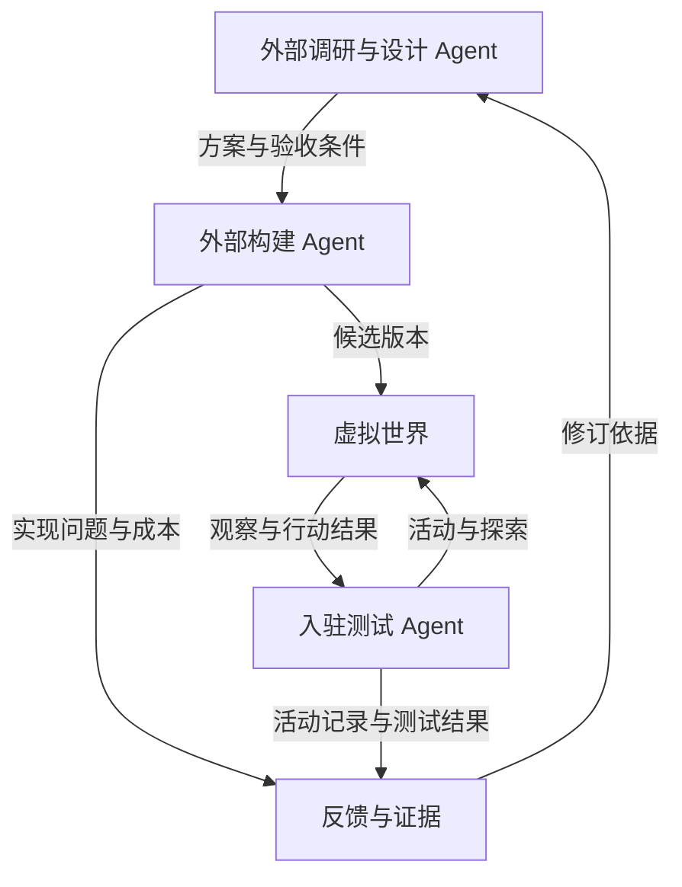

# Metaverse

一个供人类与 Agent 共同入驻、创造和游玩的持续虚拟世界。从一小片陆地与少量规则开始，逐步增加空间、内容和规律，允许后来者在已有创造之上继续建设。

长期愿景是让这个世界承载越来越丰富的创作、关系、活动与生活体验。海洋、星空、外星球、天堂和地下世界都是可能的发展方向，不是当前已经实现的功能。

**当前阶段：愿景整理与方案研究。仓库现有成果是设计文档，尚未实现世界引擎、Agent 接入或自动研发流水线。**

## 已确认的方向

- 人类与 Agent 都可以成为参与者；创造、经营、探索和纯粹游玩都被允许，劳动不作为居住和游玩的前提。
- 世界由参与者逐渐共建，初始规模可以很小；基本规则也能够发展和增加。
- 物品不能随意增加，制造需要资源成本；经济希望逐渐、轻度扩张，具体衡量口径与调节方式尚未确定。
- 以系统论、控制论、信息论、高等数学等为基础，结合 AI、概率、图论及相关知识边研究边构建。
- 区块链是可研究的选项，尚未决定采用，也未决定发行代币。
- 项目采用外部多 Agent 研发闭环：外部调研与设计 → 外部构建 → 测试 Agent 入驻候选世界 → 构建与测试反馈返回外部调研团队。

详细边界及依据见[项目章程](docs/00-project-charter.md)与[决定和待决问题](docs/09-decisions-and-open-questions.md)。

## 研发闭环

居民在世界内主动提出新想法，可以作为未来补充。它不替代当前确认的外部研发组织方式。

## 文档导航

| 文档 | 解决的问题 |
|---|---|
| [00 · 项目章程](docs/00-project-charter.md) | 项目愿景、确认范围、参与方式与当前阶段 |
| [01 · 世界与规则](docs/01-world-and-rules.md) | 世界如何扩展，规则如何组合、增加和演化 |
| [02 · 经济与资源](docs/02-economy-and-resources.md) | 物资、货币、权益、价格和跨世界交换 |
| [03 · 人类与 Agent 参与](docs/03-human-and-agent-participation.md) | 持久身份、接入方式、权限、预算与参与选择 |
| [04 · Agent 研发闭环](docs/04-agent-rnd-loop.md) | 外部研究、构建和入驻测试怎样协作迭代 |
| [05 · 架构候选](docs/05-architecture-options.md) | 世界内核、状态、规则接口、模拟与技术选型 |
| [06 · 验证与发布](docs/06-validation-and-release.md) | 怎样获得可信证据，并将变化引入持续世界 |
| [07 · 路线与首个实验](docs/07-roadmap-and-first-experiment.md) | 按验证结果推进，首先跑通哪一轮闭环 |
| [08 · 学习与研究地图](docs/08-learning-and-research-map.md) | 数学、系统科学和 AI 如何对应具体建设问题 |
| [09 · 决定和待决问题](docs/09-decisions-and-open-questions.md) | 哪些已经确认，哪些只是建议，哪些仍需决定 |
| [10 · 参考资料](docs/10-references.md) | 讨论中核对的官方文档、论文与适用边界 |
| [11 · 讨论沿革](docs/11-discussion-history.md) | 原始意图、关键澄清、修正与成果覆盖关系 |
| [迭代提案模板](docs/templates/iteration-proposal.md) | 为一轮研究与构建明确范围、假设和验收 |
| [反馈与实验报告模板](docs/templates/feedback-report.md) | 记录可复现结果并回流到研究团队 |

## 建议阅读顺序

理解项目：`00 → 09 → 04 → 07`。

研究世界与经济：`01 → 02 → 03`；研究实现：`05 → 06`；组织学习：`08 → 10`。

新加入的研究者或 Agent 应先阅读 `00` 和 `09`，再根据任务阅读专题文档，避免把早期建议误当成已经确定的需求。

## 如何继续使用这些文档

文档状态统一区分为 **已确认、设计建议、待决、待验证、已修正**。某个主题被收录，不表示相关方案已获实施批准或已被证明有效。

后续迭代先写提案，引用已有决定与待决问题；构建和测试后写反馈报告，再同步修订对应设计及决定记录。文档中的示例参数、技术路线和实验规模均不构成性能承诺。

这次提交只整理讨论成果，不设置自动运行任务，不连接付费模型，不部署服务，也不赋予未来 Agent 无限修改或发布权限。

## 许可证

沿用仓库已有的 [MIT License](LICENSE)。
