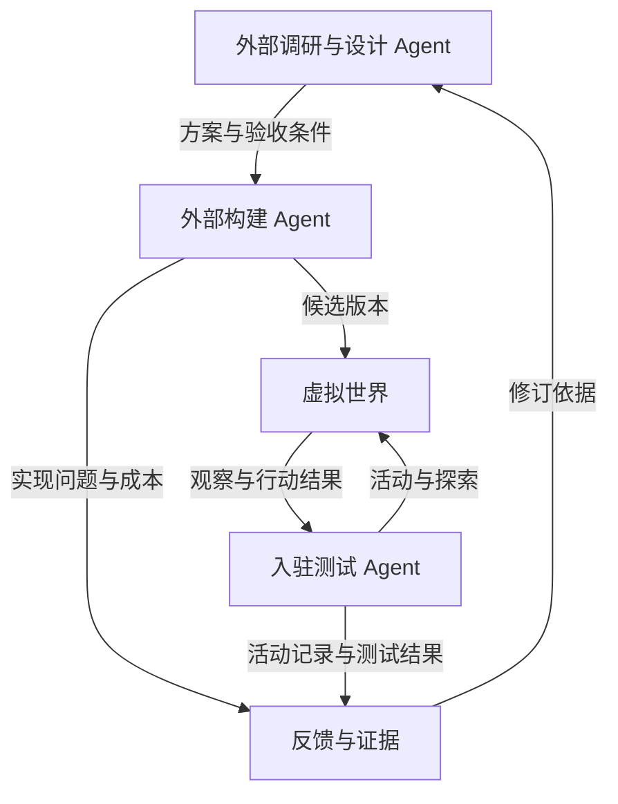

# Metaverse

一个供人类与 Agent 共同入驻、创造和游玩的持续虚拟世界。从一小片陆地与少量规则开始，逐步增加空间、内容和规律。文明随居民的实际进度发展，后来者进入的是当时的世界，并在已有成果之上生活与创造。

长期愿景是让这个世界承载越来越丰富的创作、关系、活动与生活体验。海洋、星空、外星球、天堂和地下世界都是可能的发展方向，不是当前已经实现的功能。

**当前阶段：Godot 3D 俯视原型与原始采集。居民分散在河流两岸，空手出生，没有现成建筑或公共木材。木材先存在于树木中，砍取后进入个人库存，再用于搭建和造桥。已建成果会保留，后来者进入同一个持续世界。**

客户端路线已确认：先 Godot 原型，后续迁移 Unreal。启动服务后运行 `npm run start:godot`，进入实际3D场景；运行要求、操作和迁移边界见[Godot客户端](clients/godot/README.md)。世界状态仍由现有服务维护。

最新成果：[ITER-0011 Godot俯视客户端](docs/iterations/ITER-0011-results.md) · [ITER-0010 原始开局](docs/iterations/ITER-0010-results.md) · [采集契约](docs/contracts/wilderness-v1.md) · [ITER-0009 入驻导览](docs/iterations/ITER-0009-results.md) · [导览契约](docs/contracts/entry-guide-v1.md) · [ITER-0008 提议收件箱](docs/iterations/ITER-0008-results.md) · [收件箱契约](docs/contracts/mosaic-inbox-v1.md) · [ITER-0007 协商修改](docs/iterations/ITER-0007-results.md) · [协商契约](docs/contracts/mosaic-consent-v1.md) · [ITER-0006 共同画布](docs/iterations/ITER-0006-results.md) · [ITER-0005 共同手记](docs/iterations/ITER-0005-results.md) · [ITER-0004 活动对照](docs/iterations/ITER-0004-results.md) · [ITER-0003 模型居民](docs/iterations/ITER-0003-results.md) · [ITER-0002 两地通行](docs/iterations/ITER-0002-results.md) · [ITER-0001 基础世界](docs/iterations/ITER-0001-results.md) · [底层研究](docs/research/2026-10-25-foundation/00-report.md)。

当前入口：`npm start`（或 `bash scripts/run_wilderness.sh`），打开 `http://127.0.0.1:5088`，密钥位于 `.local/wilderness/access.json`。新世界默认 `wilderness-v1` / r7：选择树木、走到相邻一格、砍取木材，然后选择空地或水面搭建。初始 4 处树木、各 3 木材和 8×8 地图是本轮原型参数。

历史脚本对应 5080—5087，数据目录相互独立，不把旧世界重置成原始开局。旧 `run_world.sh` 显式选择 foundation 实验；服务读取已有数据库时始终沿用原场景。低层服务面对未指定场景的新数据库时，也默认采用原始开局。

此前模型居民报告：打开 `http://127.0.0.1:5088/resident.html?sample=inbox-review` 查看从收件箱找到旧提议后的实际审阅，可切换提议人。页面只读历史记录，新预览仍为空。初始河流和用于挤出最近列表的 51 条已处理记录是明确程序样本，不冒充模型作品。新任务与复现命令见 ITER-0008 报告；每个新模型任务调用一次绑定账号的 GPT-6。

## 已确认的方向

- 先用 Godot 制作3D俯视原型，后续迁移 Unreal；资源与世界事实继续由独立服务管理。
- 人类与 Agent 都可以成为参与者；创造、经营、探索和纯粹游玩都被允许，劳动不作为居住和游玩的前提。
- 世界由参与者逐渐共建，初始规模可以很小；基本规则也能够发展和增加。
- 文明从独立散落的原始居民开始，玩家先自行砍木头等采集资源进行发展，再逐渐形成聚落；随着实际建设与自动化，后入者的生活可能变为城市活动乃至星际旅行，无须每人重复原始阶段。
- 先行者主要获得早期体验与适度的时长优势，不能凭先发形成过大优势或垄断；后来者需要持续存在的参与和创造机会。
- 物品不能随意增加，制造需要资源成本；经济希望逐渐、轻度扩张，具体衡量口径与调节方式尚未确定。
- 以系统论、控制论、信息论、高等数学等为基础，结合 AI、概率、图论及相关知识边研究边构建。
- 区块链是可研究的选项，尚未决定采用，也未决定发行代币。
- 项目采用外部多 Agent 研发闭环：外部调研与设计 → 外部构建 → 测试 Agent 入驻候选世界 → 构建与测试反馈返回外部调研团队。

普通回归：先 `npm ci --prefix tests/browser --ignore-scripts`，再 `npm test`。统一运行构建、全部 HTTP 和真实 Chrome 检查，不含任何真实模型调用；环境要求和单套入口见[验收说明](tests/README.md)。

详细边界及依据见[项目章程](docs/00-project-charter.md)与[决定和待决问题](docs/09-decisions-and-open-questions.md)。

## 文明如何积累

2026-10-26 的新增方向是：前人的建设应改变后来者面对的生活条件。知识、设施、服务、组织与历史可以持续积累；个人刚加入，不会让周围社会重新回到原始状态。

目前建议区分“世界软件支持什么”“居民实际实现什么”“不同居民能使用什么”，并让时代描述依据实际能力。地区差异、知识传播、公共服务和发展节奏的具体机制仍待验证，详见[文明演进](docs/12-civilization-evolution.md)。

相应新增了 `EXP-0002`“从手工建造到共享工坊”：在同一个小世界里，前一批居民建成设施，后一批直接使用并继续创造。这是首个产品实验候选，尚未实施。

进一步确认的约束是：早到不能演变为对后来者的永久控制。具体设计需要同时检查能力差距和资源、技术、设施、通道的可替代性，详见[先发优势与后来者机会](docs/13-entry-and-bounded-advantage.md)。共享工坊实验因此还需测试先行者拒绝服务时的进入路径。

## 研发闭环

居民在世界内主动提出新想法，可以作为未来补充。它不替代当前确认的外部研发组织方式。

## 文档导航

| 文档 | 解决的问题 |
|---|---|
| [00 · 项目章程](docs/00-project-charter.md) | 项目愿景、确认范围、参与方式与当前阶段 |
| [01 · 世界与规则](docs/01-world-and-rules.md) | 世界如何扩展，规则如何组合、增加和演化 |
| [02 · 经济与资源](docs/02-economy-and-resources.md) | 物资、货币、权益、价格和跨世界交换 |
| [03 · 人类与 Agent 参与](docs/03-human-and-agent-participation.md) | 持久身份、接入方式、权限、预算与参与选择 |
| [04 · Agent 研发闭环](docs/04-agent-rnd-loop.md) | 外部研究、构建和入驻测试怎样协作迭代 |
| [05 · 架构候选](docs/05-architecture-options.md) | 世界内核、状态、规则接口、模拟与技术选型 |
| [06 · 验证与发布](docs/06-validation-and-release.md) | 怎样获得可信证据，并将变化引入持续世界 |
| [07 · 路线与首个实验](docs/07-roadmap-and-first-experiment.md) | 按验证结果推进，首先跑通哪一轮闭环 |
| [08 · 学习与研究地图](docs/08-learning-and-research-map.md) | 数学、系统科学和 AI 如何对应具体建设问题 |
| [09 · 决定和待决问题](docs/09-decisions-and-open-questions.md) | 哪些已经确认，哪些只是建议，哪些仍需决定 |
| [10 · 参考资料](docs/10-references.md) | 讨论中核对的官方文档、论文与适用边界 |
| [11 · 讨论沿革](docs/11-discussion-history.md) | 原始意图、关键澄清、修正与成果覆盖关系 |
| [12 · 文明演进](docs/12-civilization-evolution.md) | 文明怎样由居民推动，自动化怎样改变玩法，后来者怎样承接当代 |
| [13 · 先发优势与后来者机会](docs/13-entry-and-bounded-advantage.md) | 怎样保留适度积累，并防止后来者被资本、资源和权限封锁 |
| [多账号 Agent 研发准备](docs/12-multi-account-agents.md) | 本机账号绑定、Orca 派工、验证及新增账号 |
| [底层实现研究](docs/research/2026-10-25-foundation/00-report.md) | 内核、存储、客户端、共同接口及实测证据 |
| [ITER-0001 · 最小世界](docs/proposals/ITER-0001-foundation.md) | 两名居民、有限资源、建造与恢复的构建范围及验收 |
| [ITER-0001 · 实现与验收](docs/iterations/ITER-0001-results.md) | 运行方法、真实测试结果、截图、修订及剩余边界 |
| [ITER-0002 · 两地通行](docs/iterations/ITER-0002-results.md) | 公共桥梁、固定策略对照、旧库兼容及恢复修订 |
| [ITER-0003 · 模型居民](docs/iterations/ITER-0003-results.md) | 真实目标选择、持久任务、预算、恢复与可核查报告 |
| [ITER-0004 · 地点活动](docs/iterations/ITER-0004-results.md) | 到访事实、四组模型与固定策略对照、人类活动与旧世界兼容 |
| [ITER-0005 · 共同手记](docs/iterations/ITER-0005-results.md) | 公开创作与阅读、两居民实际回应、草稿与分享事实、恢复及兼容 |
| [ITER-0006 · 共同画布](docs/iterations/ITER-0006-results.md) | 可操作视觉共创、两居民接续绘制、原作者与版本、冲突及原任务恢复 |
| [ITER-0007 · 协商修改](docs/iterations/ITER-0007-results.md) | 他人格子先提议、原作者决定、接受／拒绝事实、原子改图与恢复 |
| [ITER-0008 · 提议收件箱](docs/iterations/ITER-0008-results.md) | 完整待办与计数、游标分页、旧提议原引用读取、输入保留及兼容 |
| [迭代提案模板](docs/templates/iteration-proposal.md) | 为一轮研究与构建明确范围、假设和验收 |
| [反馈与实验报告模板](docs/templates/feedback-report.md) | 记录可复现结果并回流到研究团队 |

## 建议阅读顺序

理解项目：`00 → 09 → 12 → 04 → 07`。

研究文明与经济：`12 → 13 → 01 → 02 → 03`；研究实现：`05 → 06`；组织学习：`08 → 10`。

新加入的研究者或 Agent 应先阅读 `00` 和 `09`，再根据任务阅读专题文档，避免把早期建议误当成已经确定的需求。

## 如何继续使用这些文档

文档状态统一区分为 **已确认、设计建议、待决、待验证、已修正**。某个主题被收录，不表示相关方案已获实施批准或已被证明有效。

后续迭代先写提案，引用已有决定与待决问题；构建和测试后写反馈报告，再同步修订对应设计及决定记录。文档中的示例参数、技术路线和实验规模均不构成性能承诺。

初始文档提交只整理讨论成果。后续多账号研发准备及实测范围见[多账号 Agent 研发准备](docs/12-multi-account-agents.md)，不构成常驻自动运行或无限修改、发布权限。

## 许可证

沿用仓库已有的 [MIT License](LICENSE)。
