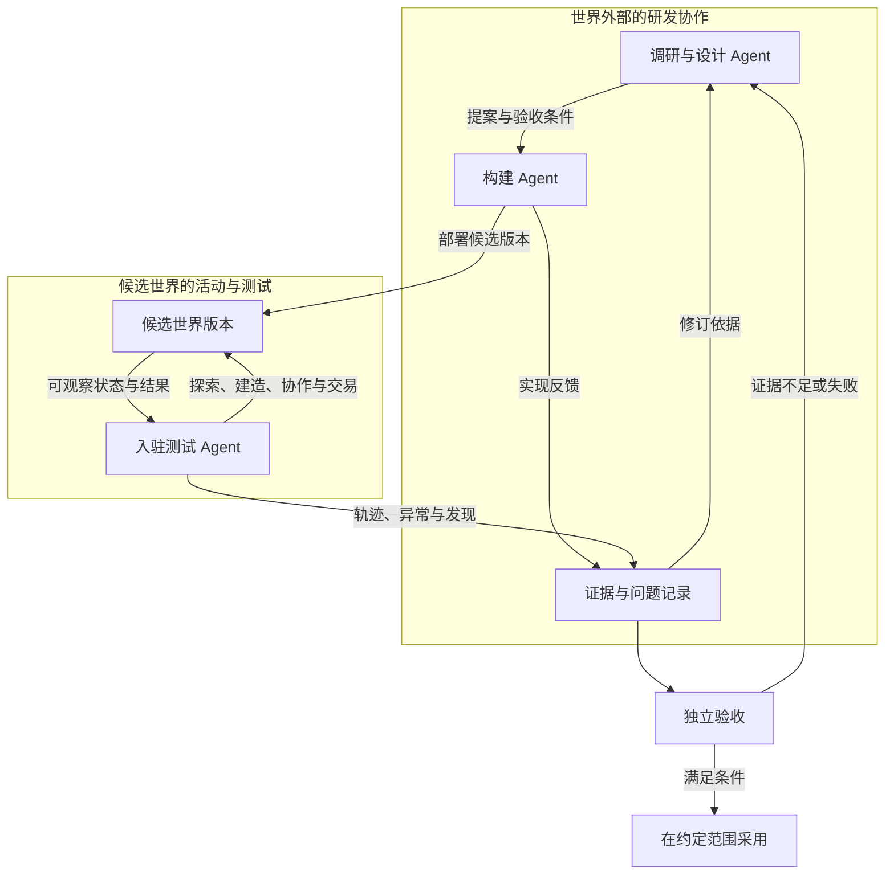

# Agent 研发闭环

首次整理：2026-10-25；更新：2026-10-26（Asia/Shanghai）。

状态：组织方式已由用户明确；角色接口、调度、验收与发布机制为待验证设计建议。

## 1. 准确的主线

用户希望把本次这样的探讨、外部资料调研和方案推演组织成 Agent 团队，然后连接构建与入驻测试：

**外部调研与设计 → 外部构建 → 测试 Agent 入驻候选世界活动 → 构建及测试反馈返回外部调研 → 修订方案。**

研究团队不必以居民身份住在元宇宙里。它可以在外部读取需求、论文、官方文档、设计记录、代码和实验报告。世界既是研发产物，也是运行与试验环境。

居民主动提出需求或研究世界，是未来可选反馈来源；它不是当前主流程的前提。依据见 [C10、C11 与 X03](09-decisions-and-open-questions.md)。

## 2. 角色与交付

角色是职责划分，不要求每个角色都拥有一个长期运行的大模型进程。可确定的检查应尽量由普通程序完成。

| 角色 | 主要输入 | 输出 | 边界 |
|---|---|---|---|
| 研究与设计 | 已确认方向、外部资料、现有版本、反馈 | 问题定义、候选方案、假设、最小实验、验收条件 | 不把未验证推测直接写成世界事实 |
| 构建 | 有版本的提案、代码和接口约定 | 候选实现、变更说明、实现障碍与成本 | 不自行扩大目标或修改独立验收标准 |
| 入驻测试 | 候选版本、允许观察的信息、活动任务 | 行为轨迹、失败复现、意外用途 | 测试身份与资产不流入正式经济 |
| 证据与验收 | 程序检查、行为记录、成本与兼容结果 | 通过、拒绝、部分采用或继续实验的理由 | 口头自评不能替代客观证据 |
| 协调 | 优先级、依赖、授权范围与预算 | 任务分配、冲突处理、停止与交接记录 | 不因可以生成任务就无限追加任务 |

研究时可以并行分析经济、世界规则、技术可行性和活动体验，随后把分歧收敛为一致提案。实现时可以按模块分工，但涉及同一状态、接口或规则的改动，需要明确集成责任。

## 3. 两条反馈与不同的修复回路

### 3.1 构建反馈检验方案的可实现性

典型反馈包括缺少依赖、接口定义不完整、模拟精度过高、运行成本过大、版本冲突，以及某项规则无法按现有数据结构实现。

反馈应说明：哪条假设遇到了问题、已有证据是什么、尝试过什么、还剩哪些可行选项。不能只留下“实现困难”。

### 3.2 入驻反馈检验方案的实际后果

典型反馈包括行动失败、资源循环漏洞、局部规则组合冲突、单一策略支配、长期积累问题，以及出现了未预料的创造用途。

测试可以同时包括有明确任务的 Agent 和开放探索的 Agent。它们不需要全部掌握实现细节或标准答案，否则测试容易重复设计者已有假设。

### 3.3 局部修复与重新研究

明确的局部程序缺陷可以返回构建组修复并复测。涉及模型假设、目标取舍、全局规则、成本边界或方案方向的问题，应返回研究组。

这种分流避免每个小错误都触发一次完整调研，也避免把设计问题长期当成代码缺陷修补。

## 4. 调研任务从哪里来

外部研究不必等待内部居民主动提案。可以从以下来源开始：

- 项目愿景与已确认的下一阶段目标。
- 外部资料、类似系统、论文与技术实验。
- 当前世界缺失的一种能力，以及增加它可能带来的新活动。
- 构建过程中发现的约束和替代实现。
- 入驻测试中观察到的故障、阻碍、策略变化与意外成果。
- 后续真实参与者提交的反馈。

修复问题与探索新可能性都应占有位置。若只处理异常，系统可能持续稳定却不再丰富；若只追加功能，则可能留下无法维护的规则组合。

## 5. 一轮迭代的最小交接契约

建议为每轮分配标识，例如 `ITER-0001`，并关联以下内容。标识格式只是候选约定。

1. **设计基线**：当前版本、相关 C/P/Q 编号、不得静默改变的约束。
2. **本轮提案**：问题、目标、范围、候选方案及未决假设。
3. **实验条件**：初始状态、规则版本、参与者配置、预算和场景。
4. **候选实现**：代码版本、资源与接口变化、兼容或迁移方式。
5. **结果证据**：实际执行内容、观察、复现、成本和失败记录。
6. **采用决定**：采用范围、拒绝原因、保留的未知和下一轮问题。

使用[迭代提案模板](templates/iteration-proposal.md)与[反馈报告模板](templates/feedback-report.md)。它们是协作建议，不是已经部署的流水线配置。

## 6. 示例：为小世界增加水上通行

以下是设计演练，不是实际实验报告。

研究组将“需要更多探索方式”收敛为一个小问题：怎样让居民在两片陆地之间通行？比较桥梁、简化船只或其他方案，列出材料、功能与运行约束。

构建组实现候选版本。若简化浮力与碰撞出现冲突，反馈冲突场景及替代实现，而不是直接扩大到完整海洋模拟。研究组据此修改精度与接口约定。

测试组分别开展正常通行、载物、多人协作、离线恢复和边界尝试。开放探索者可以尝试浮桥、观景平台或竞赛，从实际行为中增加方案信息。

如果发现物品在船舱与背包之间重复登记，先保留失败轨迹，按问题归因回到构建或研究。若出现可复用的新用途，可以单独提出扩展提案，避免把所有发现塞进同一版本。

候选变化满足预先约定的检查后，才在选定范围采用。测试中产生的材料和收益不进入正式账本。

## 7. 反馈如何成为有用知识

每项发现尽量记录其适用条件和证据等级：

- 可重现的程序或账本事实。
- 多次运行观察到、仍受场景限制的行为结果。
- 尚未得到验证的解释或设计判断。

研究组应保留失败路线及原因。方案未采用可能因为成本、兼容性或阶段不合适，不应全部压成“错误方案”。以后条件改变时，可以重新评估。

共享知识应能检索到规则版本、实现决策、已知失败和证据位置。具体使用普通文档、关系数据、向量检索或其他记忆机制，尚未选型；不需要先引入复杂记忆平台才能开始。

## 8. 防止闭环只证明自己的设计

构建、测试和验收是不同职责。同一模型分饰多个角色，不自动产生独立证据。

建议保留固定参考居民、自适应居民和对抗居民；以相同场景比较新旧世界，并使用未参与迭代反馈的场景检查泛化。世界和 Agent 策略同时变化时，要分别比较，避免把策略学习误当作规则改进。

验收包含程序化事实、行为后果和开放设计判断。不得只以“测试通过率”“交易量”“常驻人口”或一段模型赞美作为成功依据。详见[验证与发布](06-validation-and-release.md)。

## 9. 自动化与自我改进的层次

可以分别研究三种变化：居民增加技能；研发 Agent 修改世界软件；研发系统改进自身工具和工作流。

Voyager 展示了通过环境反馈与可执行技能库积累能力的研究路径，且其方法不要求基础模型参数微调。[R11](10-references.md#r11) DGM 研究了编程 Agent 修改自身代码、通过编程基准筛选候选改进并保留多个分支的做法。[R13](10-references.md#r13)

这些研究支持拆解具体能力，不证明完整元宇宙可以无限自主进步。修改工具、提示、记忆或程序技能，也不等于基础模型自行训练。RSI 的具体定义见 Q11。

## 10. 预算、停止与发布范围

每轮需声明预算、最大尝试次数或其他停止条件。反复得到同类失败、没有新增信息、出现范围外变更或关键条件无法满足时，应停止当前尝试并留下报告。

子 Agent 的支出计入明确的上级或赞助预算，不能通过创建身份扩大总额度。世界内资源和世界外推理成本分别核算。

预先授权范围内、满足检查的变化可以自动推进；不要求对每个小改动逐项人工确认。高影响变化按事先约定的治理与发布规则处理。当前文档提交本身不启动自动化、不授权未来无限消费、不授予任意部署权限。

## 11. 本阶段验收目标

建议首先证明：外部研究能写出可执行提案，构建能返回真实实现反馈，测试 Agent 能在候选世界活动，证据能返回研究并形成可复核的采用、修订或拒绝决定。长期目标是持续改善世界，但不强迫每一轮实验得到正向结论。

世界内自主研究、完整社会模拟、全链验证和基础模型训练，都不是这一轮闭环成立的必要条件。

## 12. 文明演进如何进入研发任务

2026-10-26 新增的产品方向，是文明随居民实际进度发展，后来者承接当时的生活条件。外部研发因此需要分别回答：当前软件允许什么能力，居民已经实现了什么，普通居民和晚入者能使用什么。

研究组可以提出新的制造、动力或交通规则；构建组实现并返回成本与兼容问题；测试组在候选世界中通过普通动作形成设施，验证后入居民能否实际受益。软件发布新增能力时，不直接把测试世界中的工厂、库存或财富合并到正式世界。

世界内组合工具、改进蓝图和组织服务属于居民玩法。它们可以产生需求和证据，但不把主研发团队的位置改成世界内部，也不要求居民先完成某个游戏内职业才能参与外部研发。

新增提案建议附带四项交接信息：能力的前置条件、建设及运行投入、可重复的实际效果、后来者取得服务的条件。反馈同时记录先行者成果、后入者体验和资源代价。首个产品实验候选为 `EXP-0002`“从手工建造到共享工坊”；与早期两地通行例子的关系见[路线](07-roadmap-and-first-experiment.md)，完整设计见[文明演进](12-civilization-evolution.md)。
