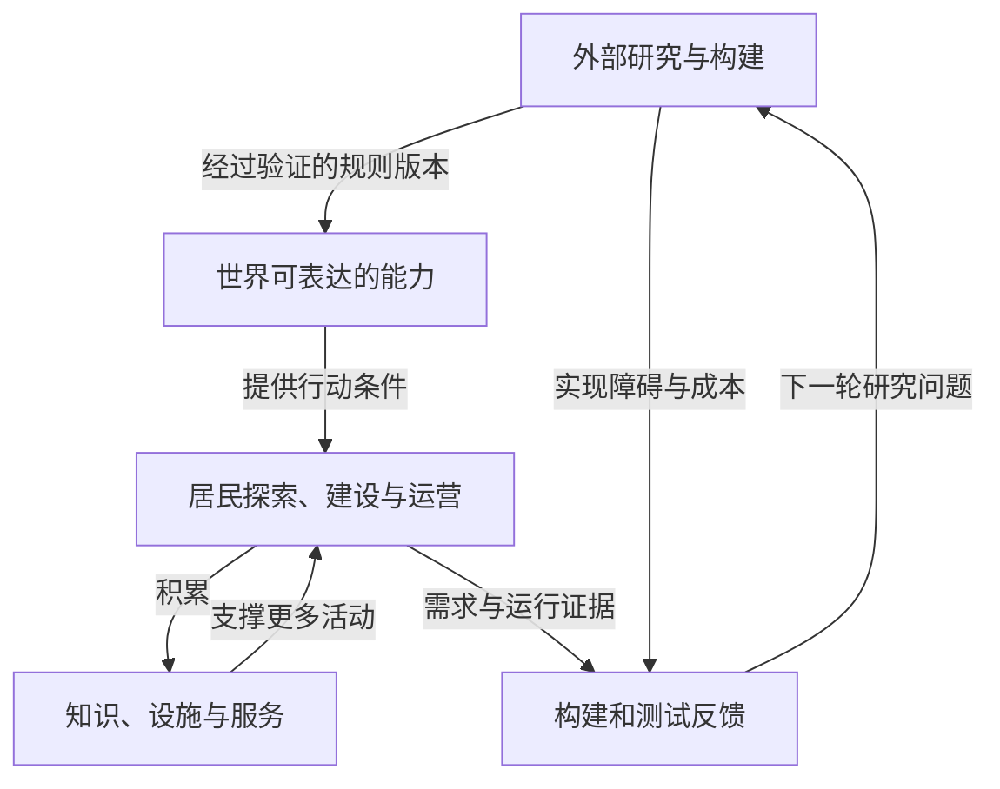

# 文明演进：居民推动历史，后来者承接当下

日期：2026-10-26（Asia/Shanghai）。

状态：本轮新增产品方向已由用户明确；本文的状态模型、制度、发展路径和实验方案是设计建议，尚未实现或验证。

关联：[项目章程](00-project-charter.md)、[世界与规则](01-world-and-rules.md)、[经济与资源](02-economy-and-resources.md)、[参与方式](03-human-and-agent-participation.md)、[研发闭环](04-agent-rnd-loop.md)、[实验路线](07-roadmap-and-first-experiment.md)。

## 1. 本轮确认：世界有共同历史，新人进入的是当代

用户进一步明确：文明会发展，发展速度取决于玩家的进度。用户随后进一步确定：最早进入的是独立散落的原始居民，玩家需要自行砍木头等采集资源推动发展，随后逐渐形成部落；后来的居民进入时，当地可能已经有自动化、摩天大楼，甚至星际旅行，基本活动随之改变。

[ITER-0010](iterations/ITER-0010-results.md) 已落实分散空手出生、树木采集和采集后建造的最小原型。原公共领料实验仍保留为历史世界；初始树木、地图尺寸与数量是实验参数，生态、工具和部落仍待实现。

对应决定 C13—C15。结合此前人类和 Agent 都可入驻的方向，本文用“居民”指世界内的参与者；外部研发 Agent 的软件工作另行记录。

由此，建设成果需要跨越单个玩家的上线周期：前人留下的知识、设施、作品、组织和历史，能够成为后来者的生活条件。后入玩家可以继续建设，也可以使用当代服务、探索与游玩。

已确认的是这种产品方向，尚未决定固定年代、每个时代的持续天数、统一科技树、人口门槛、社会制度或最终文明形态。自动化城市与星际旅行是可能的远期状态，不是已实现功能或必然结局。

**建议将核心产品承诺表述为：居民可以改变后来者进入世界时面对的生活条件。**

## 2. 研究依据：可以借鉴哪些机制

本轮核对了游戏开发者资料、官方机制文档与研究论文。下面的设计启发是本项目的推论，不能把外部产品的机制直接当成本项目已经得到验证的结论。

| 资料 | 可核对的机制或研究对象 | 对本项目的启发与边界 |
|---|---|---|
| One Hour One Life | 官网描述跨世代使用与传承工具、建筑，后来角色出生于不同处境 | 可借鉴社会成果超过个人生命周期；不必采用其一小时寿命、育儿或生存压力，也不能据此证明永久不清档已经解决。[R14](10-references.md#r14) |
| Eco：Upgrade Modules | 2020 年开发博客把效率收益放在工作台升级模块上，使用设备的新玩家可获得同样的成本改善 | 技术可以沉淀在共享设施中；借鉴设备收益，不照搬劳动制度，也不把历史博客的平衡参数当成当前规范。[R15](10-references.md#r15) |
| Factorio | 团队可共享研究状态；蓝图记录布局，实际建造仍需材料；开发者介绍过基于实际行为触发技术的设计 | 知识、制造与实践证据可以分开；不因此选定固定科技树或无限生产率加成。[R16](10-references.md#r16) |
| Screeps | 脚本在持久世界中按 tick 行动，执行受 CPU 额度约束 | 自动居民可以持续行动，同时需要统一世界时间和计算预算；不照搬具体付费或竞争规则。[R17](10-references.md#r17) |
| Factorio Learning Environment | 2025 年论文研究长程规划、程序生成与资源优化，并报告其受测模型在复杂自动化上的限制 | 可以用真实生产链检验 Agent；论文只描述当时受测模型与环境，不代表当前所有模型的能力上限。[R18](10-references.md#r18) |

这些来源分别支持部分机制。尚无本项目证据证明它们组合后一定产生长期有趣、经济稳定且无限发展的文明。

## 3. 分开记录三种进度

| 进度 | 表示什么 | 例子 |
|---|---|---|
| 世界软件与规则能力 | 当前版本允许哪些事情发生 | 引擎已支持动力、制造、航行或当地魔法 |
| 文明实际状态 | 居民已经建成、组织并持续运行了什么 | 某城有可用电网、工坊和交通服务 |
| 个人状态 | 某居民知道什么、拥有什么、能做什么 | 新人不会造发动机，但有资格乘坐公共交通 |

软件发布“航天模块”后，世界获得实现航天的可能性；居民仍需研究可用设计、投入材料、建设设施和组织运行。不能因版本更新就在正式世界免费生成宇航港，也不能因一个新人注册就重置城市。

个人学习也不必复制完整文明史。学习如何预约工坊、使用工具或参加活动，可以成为当代新手教程；不必要求每个人先制造历史上所有前置工具，才能使用已有服务。

世界内居民对装置与工艺的探索属于玩法；扩展世界软件的研究和构建，仍由已确认的外部研发闭环承担。两条过程可以交换需求和证据，但它们的身份、预算、权限与结果不能混用。

## 4. 用能力分布描述文明

建议按地区保存或推导以下信息。它们是不同类型的状态，不是可以直接相加的六个分数。

| 维度 | 需要知道什么 | 典型误判 |
|---|---|---|
| 知识与证据 | 蓝图、工艺、程序、操作方法、适用条件、验证与传播范围 | 把一段“已发明飞船”的文字当成成功 |
| 实体设施 | 已建设备、建筑、网络和连接关系 | 把建造菜单中的图标当成已有产能 |
| 实际服务 | 已交付什么；当前能承诺什么容量、品质和持续时间 | 把额定能力或一次演示当成稳定供给 |
| 居民可达性 | 谁能到达、负担、预约和使用；需要等待多久 | 某人有飞船，就宣布所有人进入星际生活 |
| 运行与维护 | 材料、能源、备件、库存、设备状况和负责主体 | 解锁一次后永远无条件有效 |
| 社会与文化积累 | 组织、共同约定、作品、活动、传承与建设记录 | 只用工业产量和楼房高度衡量文明 |

可达性应按居民或群体查询：同一座城市对老居民、刚加入者、不同组织成员和外来访客，可能提供不同条件。知识公开范围也应明确，不能把私人未公开设计显示给所有居民。

“部落”“工业城市”“星际文明”可以是对这些事实的概括，最好带地区、时间和依据。建议不维护一个自动递增的全球文明等级，更不把它变成所有玩法的唯一总分。

保留传统建筑、低能耗生活或艺术表达可以是居民的主动选择；技术路线不同不等于文化价值较低。

## 5. 技术怎样成为文明成果

### 5.1 从知道到普遍可用，需要不同证据

| 状态 | 需要的证据 | 尚不能说明什么 |
|---|---|---|
| 提出方案 | 设计、假设、所需条件 | 尚未证明可以运行 |
| 完成验证 | 在约定条件下可重现的行为与结果 | 尚未证明有材料批量建设 |
| 合法建成 | 材料和设备投入、对象与权益记录 | 尚未证明可以长期供给 |
| 持续运行 | 投入、产出、故障和服务记录 | 尚未证明后来者有访问机会 |
| 传播与使用 | 合法传播、实际服务使用、居民访问条件 | 仍不能保证所有地区同时获得能力 |

阶段允许并行与回退，不能把一次实验自动晋升为全世界的常态能力。前沿技术的首次成功值得记录，基础服务的广泛可用也值得记录，两者分别反映不同进展。

### 5.2 在已有规则内组合发明

若引擎已经表达传动、能源、材料转换和控制逻辑，居民可以尝试新的组合，形成水车、自动工具、物流程序或表演装置。有效设计保存为带条件与版本的蓝图，别人可以据此制造与运行。

初版可先采用有限的声明式配方与组件，再逐步开放组合空间。不能预设少量基础物理就会自然涌现出所有现代技术；有些能力需要专门规则，模拟精度应服务于玩法和可验证性。

### 5.3 超出现有能力时，连接外部研发

若引擎还没有轨道、载客或跨区域航行，居民提出“飞船”只是一项需求或设计。外部研究组提出可实现的规则，构建组实现候选版本，测试组入驻验证，再依据结果在适当范围采用。

正式采用的是规则能力、定义及必要迁移。测试库存不能变成正式材料，测试城市也不能作为免费生产资产复制进入公共经济。

### 5.4 不以玩家忘记现实知识作为进度约束

人类和预训练 Agent 都可能知道现代技术概念。建议允许他们带着这些知识探索；世界中的可行性仍由本地规则、资源、设备、执行能力和权限决定。

可以知道冶炼原理，却没有合适的原料和炉子；也可以给出漂亮的设计，但在当前规则中无法运行。是否把部分设计作为需发现的内容，属于玩法选择，不能仅靠“配方保密”控制文明速度。

## 6. 科技依赖与发展路线可以分叉

建议用有条件的能力依赖关系描述发展，不预先把全部地区放入同一条年代阶梯。

以“跨海到达”为例：

| 候选路线 | 需要共同满足的条件示例 |
|---|---|
| 桥梁 | 结构能力、材料、适宜场地与施工能力 |
| 船运 | 船体与航行规则、港口、运行能源与运营安排 |
| 当地传送 | 已采用的传送规则、当地资源与通行条件 |

同一路线下的条件可能需要同时满足；不同路线可能互相替代，也可能组合。这里的传送仅是与原有奇幻世界愿景相容的例子，尚未决定实现。

邻近地区有铁路，边远地区可能仍以河运为主；一个新星球可以拥有从母星带来的先进知识，同时缺少当地制造能力。若允许运输成熟设备，就应允许跳过部分本地制造步骤，不能用隐藏规则强行重复石器时代。

愿意体验原始生活的人，可以研究自愿加入边境或特定主题地区的方案。若地区限制进口、技术或自动化，须公开其规则；这属于玩法与治理选择，不是后来者的默认惩罚。

## 7. 随文明变化的是问题和玩法

以下是体验演示，不是固定年代顺序、交付清单或时间表。

| 当地条件 | 建设者可能关心什么 | 后入者或纯游玩者可能做什么 | 变化的证据 |
|---|---|---|---|
| 散落的原始居民 | 采集、工具、庇护、合作和初始储备 | 探索、结识同伴，参与已有活动或自愿帮助建设 | 有限工具、营地与共享库存形成 |
| 部落与定居聚落 | 稳定供给、储存、工坊、公共路径 | 使用已有工具和营地，参与交换、节庆和创作 | 后人能复用前人的设施和方法 |
| 机械化地区 | 动力、材料加工、运输与维护 | 通过共享设施取得物品，设计自己的作品 | 部分重复劳动由设备承担 |
| 自动化城市 | 系统协调、服务质量、环境和复杂建设 | 乘车、观展、游玩、经营、设计建筑或举办活动 | 新居民能实际使用持续运行的服务 |
| 星际网络 | 远距离交通、补给、异星社区与新环境 | 旅行、探索、文化交流和参与新地区建设 | 航线和目的地可进入、有供给、可返回 |
| 奇幻发展分支 | 按当地规律建立新工具、空间与社会形式 | 魔法、地下世界、天堂等当地玩法 | 规则能力、资源与身份转换真实成立 |

自动化允许基础材料变得容易取得，也让居民把时间投入更复杂的创造、关系和活动。玩法更新应围绕新选择展开，不必通过恢复已经消除的重复劳动来延长流程。

世界可以保留旧工具、旧村落和早期建筑，让居民看见历史。历史体验可采用展览、复原活动或独立试验副本；副本物品仍遵守与正式账本的隔离约定。

## 8. 文明速度由有效行动和约束共同决定

### 8.1 区分三种时间

- **现实时间与费用：**模型调用、服务器、存储与人的时间投入。
- **权威模拟时间：**制造、移动、生态和维护依据的世界时间。
- **文明进展：**新增的可验证知识、设施、组织与可用服务。

模拟时间经过一小时，已有机器可以按条件生产，但不意味着系统自动发明下一时代的技术。没有新指令时，已经安排的生产、研究或建造仍可以继续；没有居民在线也不等于没有任何有效行动。

文明速度可以因协作、工具和自动化提高，也可以因缺料、组织冲突、维护不足或选择休闲而放缓。不同能力的增长率并不相同，不能简单写成“玩家数乘在线时长”。

### 8.2 Agent 可以加速发展，推理能力仍需转成合法行动

Agent 可能改善设计、排程、探索和协作，也可以运行既有设施；这些贡献应通过正常动作产生结果。增加模型调用次数，不能让一台机器在相同模拟时间内突破自身吞吐，除非居民实际建设更多设备或采用了获准的新技术。

一个教学例子：某设施每天最多生产 50 件工具；每天可获得 100 单位材料、60 单位能源；每件需要 2 单位材料、3 单位能源。忽略其他约束时：

$$
Q_{\max}=\min(50,100/2,60/3)=20\quad\text{件/日}
$$

增加 Agent 数量不会自动改变这个上限。若合法技术把单件能耗降为 1 单位，上限才变为 50 件/日。这里各项都已换算成同一产品、同一期间的产量；不是把不同单位的原始资源直接取最小值。实际还要考虑运输、库存、维护与需求。

Screeps 的 tick 与 CPU 预算提供了世界执行和计算成本分别管理的参考。[R17](10-references.md#r17) 本项目具体动作粒度、并发、预算和时间倍率仍待设计。

### 8.3 不通过强制真人操作维持文明速度

不建议规定“必须由人类亲手砍够数量才能进入新时代”，也不建议仅为拖延发展增加无意义等待。建造工期、能源、物流和设备占用可以作为可理解约束；其参数需要从玩法与系统承载能力实验中选择。

若大量 Agent 很快走完已有内容，应研究组件组合、地区差异、文化与社会活动、新的可表达能力，以及研发的供给速度。不能因此宣称系统能够无限自动生成有意义的新技术；有限软件在某一时点总有表达边界。

## 9. 后入者怎样继承文明

继承的首要对象是当时可取得的知识与服务机会，不是无条件取得其他居民的私人财产。

建议入驻时查询所在地的真实条件：有哪些公共或开放设施、当前是否运行、使用价格和权限、等待时间、可参加的活动，以及需要学习哪些操作。界面和 Agent 观察接口都应提供相应信息，并显示信息更新时间。

| 场景 | 可采用的入驻体验 | 需要保留的条件 |
|---|---|---|
| 早期营地 | 认识当地居民、工具、共享储备与探索路线 | 如实说明供给有限；共享物资需要来源 |
| 成熟城市 | 使用交通、公共创作空间和现有活动，学习当代工具 | 能实际预约与使用，不能只有宣传图标 |
| 新开拓地区 | 携带许可范围内的知识、工具和设备，参与建设 | 运输和资源成本；不默认失去旧知识 |
| 传统或主题地区 | 自愿体验当地生活方式 | 明示当地规则与离开途径 |

新人可能需要学会操作交通系统，但不必亲手制造发动机才能买票。若既有设备只对少数人开放，应如实报告访问限制，不能用全球最高技术掩盖普通居民的体验。本轮进一步确认不得形成垄断后，仅报告限制已经不够；还需验证基础参与和创造存在实际可用的进入或替代路径，具体保障范围和制度待定。

公共知识库、共享工坊、基础服务额度、开放通道与可扩展创作空间都是候选机制。其管理者、容量、资金和物资来源仍待决定；不要用每个新账号都能领取并转卖的无限礼包代替文明积累。

早期的生存条件与“不劳动也可参与”需要一起设计：可考虑愿意建设的居民、已获预算的 Agent 与有上限的启动储备支持初始共享服务，具体方案尚待验证。早期不会凭空拥有城市级福利，但也不应把个人生产配额设为入驻资格。

## 10. 经济随生产能力变化

### 10.1 允许技术进步降低基础成本

自动化使木材、工具或普通服务更容易取得，与文明进步的目标一致。某些基础品价格下降，不自动等于经济失败；需要同时观察实际服务、缺货、使用量、收入分布和运行成本。

此前“逐渐轻度膨胀”的口径仍未确认。不能为了维持所有物品持续涨价，偷偷降低先进设备效率或销毁有用库存。具体货币与物价分析仍以[经济与资源](02-economy-and-resources.md)为准。

### 10.2 新瓶颈可以出现，已解决的需要不必重做

约束可能从手工采集转向能源、精密制造、交通网络、协调复杂度、公共服务容量或远距离运输。音乐、社群、竞技、探险和个性化创作也可以持续产生价值，不必把所有居民赶进同一个生产竞赛。

新能力增加可选择的活动，同时应衡量实际需求。无人使用的机器和库存不能只因数量增长就被算作文明繁荣；平台 Agent 内部交易也不能冒充独立需求。

### 10.3 先行者有历史价值，后来者仍需发展空间

用户同日进一步确认：先行者主要体验早期内容，并获得适度时长与先发优势；不能因早到而优势过大或形成垄断。此处的参与机会因此成为已确认的目标，具体制度仍是建议。

可以通过建设记录、署名、作品传承、服务收益或有预算的研发采购认可先行者，但合理回报不能成为无限扩大经济控制力的豁免。历史作品可以独特，关键参与条件需要保持可进入、可替代。

应同时测试累积能力差距，以及关键土地、交通、设施或知识被少量主体控制时，新人是否仍有实际的加入与创作路径。公共服务、共享设施和私有经营可以组合，具体权利、供给与量化门槛见[先发优势与后来者机会](13-entry-and-bounded-advantage.md)，不预设所有资产采用同一种制度。

## 11. 持续历史、维护与衰退

用户确认文明发展，但尚未决定衰退、灾难、战争或清档规则。建议将历史记录、知识保留、设施状况与当期服务分开处理。

例如电站停运时，电力服务可能减少，但有关发电的知识不必被删除；恢复服务也应取决于实际库存、维修与供给。服务是否退化、何时退化，必须符合事先声明的规则，不能通过后台随机扣除成果制造戏剧性。

不建议把定期清空正式世界作为保持新鲜感的默认方案。若需要赛季、灾变或重开体验，可研究自愿加入的独立世界及清楚的历史归档；与持续主世界的关系另行确定。

研发试验可以恢复快照，正式世界的更新应保留有效历史、作品与交易。是否提供长期遗产保存、保护区、维护托管和退出交接，仍是需要明确成本与责任的制度问题，不能由“持续世界”推导出无条件永久存储承诺。

## 12. 世界软件供给与文明需求之间的反馈

这里的居民活动可以来自隔离测试，也可以来自正式运行中获准使用的反馈；二者的身份、资产和统计仍需区分。外部团队可以主动研究，不必等待居民先在游戏里提出问题。

建议在研发提案中分别记录：新增什么可表达能力，居民需要做什么才能实现它，哪些服务能够因此改变，如何验证后来者实际受益。代码增加行数、科技菜单变长和自动生成更多装饰，不能单独证明文明已经发展。

## 13. 首个产品实验：从手工建造到共享工坊

建议使用 `EXP-0002`，作为与本轮方向直接对应的首个产品实验候选。原 `EXP-0001` 两地通行保留为可选的基础机制实验；编号区分方案，不代表它们已经运行。完整交接见[路线与首个实验](07-roadmap-and-first-experiment.md)。

实验应在一个持续的小世界中记录完整过程：

1. 初始只有有限资源、基础工具和可理解的手工行为，不直接投放成熟工厂。
2. 第一批居民通过合法动作组织资源，建成能够按声明条件运行的共享工坊，并设置清楚的使用与维护安排。
3. 后一批新身份进入同一个世界，通过已有工坊或库存完成创作与活动，无须重做前一批的全部手工流程。
4. 先行居民离开后，观察已有资产与已授权任务能否按规则持续；新居民能否接续运营或继续改进。

初版只需少量材料、一类共享制作服务、一份设计和一个有意义的用途。服务可以先由居民 Agent 运营，再验证设备自动加工；实际自动化程度分别记录，不以完全无人运营作为文明继承成立的前提。原料采集、配送或生态可以暂时简化并明确边界，不能因为有自动加工，就宣称整个供给链已自动化。工坊按选定规则消费材料及能源或其他运行投入，公共额度需要真实预算或库存。

| 对照或扰动 | 要回答的问题 | 不可伪装成成功的结果 |
|---|---|---|
| 同一初态，有建设／无新建设 | 差异是否来自实际行动积累 | 到日期自动出现设备，或隐藏管理员赠送 |
| 早入／晚入，同样身份条件 | 后来者是否实际用上当代服务 | 城市外观变了，仍被要求逐项重做原始劳动 |
| 固定设施和模拟时间，改变 Agent 预算 | 算力通过什么行为改善结果 | 模型调用直接增发资源或跳过设备能力 |
| 中断供应，再恢复 | 知识、库存、设备与服务是否正确分离 | 永久无条件产出，或短暂停供抹掉所有知识 |

主要观测量包括合法资源变更、实际交付、服务取得时间与价格、必须重复的操作、设施利用、知识复用和现实费用。初态、地区、控制主体、规则版本与观察期间都要记录。

阈值在实验前约定。更多 Agent 没有提高产量，可能是发现了真实瓶颈；没有改善也可以形成有价值的否定结论。Agent 可以验证操作路径和资源事实，真人是否觉得好玩、易懂、有创造空间，仍需自愿体验反馈。

本版未运行这些实验，没有通过率、发展速度或经济稳定性结果。

## 14. 近期应优先明确的选择

建议接下来按依赖顺序讨论以下问题，详见 Q15—Q21：

1. **知识与传播：**什么是公共知识，什么有许可或组织边界；复制设计与制造实例如何衔接。
2. **早期参与和晚期入驻：**初始共享供给从哪里来，新人进入哪个地区，如何获得实际服务与创作空间。
3. **时间与自动化：**世界时间如何推进，Agent 的实际执行和现实预算怎样分别约束，是否需要公开的体验节奏安排。
4. **连续性与地区差异：**允许多大程度的停运、衰退、地区自治与技术迁入；哪些历史应保留。
5. **技术形成与时代描述：**初版用配方、组件还是实验发现；按哪些可观察条件描述当地文明。

当前建议先验证一项最小事实：前人的建设是否真的让后来者获得一种新的生活或创造方式。它将直接检验这次补充提出的核心价值。
