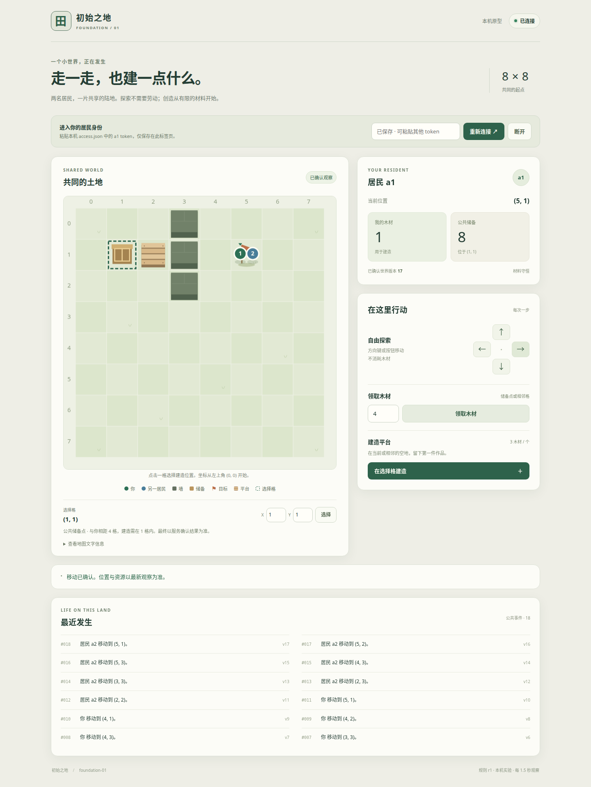

# ITER-0001：本机最小世界已实现并通过验收

日期：2026-10-25。状态：**本机原型可运行，17 项 HTTP 验收与 10 项真实 Chrome 验收通过**。不是公共上线、长期经济或多人容量验证。

## 已交付

C#/.NET 权威服务与 SQLite 持久化、中文二维浏览器客户端、经真实 API 行动的固定策略居民、可重复运行的验收器。世界为 8×8 陆地，两个居民共享位置和平台；领取从 12 单位有限公共木材转移，建造消耗 3 单位形成一个有身份和成本记录的平台。移动免费，固定居民无需领取或劳动也能抵达目标。

所有状态变更由服务裁决。身份与会话、规则版本、世界版本、规范化命令 ID、回执、事件和资源账本已实现；并发、重复、超时和进程退出保持原命令含义。浏览器在发送前将原请求保存在本标签页，结果未知时暂停新动作，支持查询和原样重试。

实现：[服务](../../src/World.Server/Program.cs)、[状态与动作](../../src/World.Server/WorldService.cs)、[数据库](../../src/World.Server/WorldDatabase.cs)、[客户端](../../src/World.Server/wwwroot/app.js)、[固定居民](../../scripts/foundation_agent.py)。接口以 [foundation-v1](../contracts/foundation-v1.md) 为准。

## 启动与操作

需要 .NET 10 SDK。在仓库根目录执行：

```bash
bash scripts/run_world.sh
```

打开 `http://127.0.0.1:5080`。首次启动在 `.local/world/access.json` 写本机凭据，将 `sessions.a1.token` 输入页面；token 不出现在 URL、代码或日志中。当前交付时已在 Orca 的 **World preview 5080** 终端启动，并在该工作区浏览器连接 a1；a2 已由固定策略走到目标。此预览独立于验收数据库，公共材料仍为 12。

点击格子选择位置；方向键或方向按钮移动；在储备点附近领取木材，消耗 3 木材建平台。已有状态保存在 `.local/world/world.db`，正常停止后重启继续使用；停止预览在对应终端按 Ctrl+C，不需要停止其他服务。该进程没有注册系统服务或开机启动。

固定居民命令：

```bash
python3 scripts/foundation_agent.py --actor a2
```

会话有效期 24 小时，撤销或过期不会因重启复活。停服后可以签发新会话：

```bash
WORLD_DATA_DIR="$PWD/.local/world" dotnet src/World.Server/bin/Debug/net10.0/World.Server.dll issue-session --actor a1 --ttl-seconds 86400 --output "$PWD/.local/world/a1-renewed.json"
```

新 token 位于输出文件，旧 `access.json` 不会自动改写。续发后在页面粘贴新 token；同一居民仍可查询历史命令。当前是受信任本机操作者签发方式，不是公开注册和登录系统。

## 验收与证据

| 提案条件 | 本轮结果及对应证据 |
|---|---|
| F01 两种入口 | 真实浏览器按钮、方向键绕墙；固定 BFS 居民经 HTTP 到达目标，0 模型调用；穿墙拒绝 |
| F02 有限资源 | 初始 12；领取 4 后公共 8；建造后库存 1、平台内含 3；再次建造拒绝 |
| F03 幂等 | 16 次并发同 ID 返回原回执，只执行一次；属性顺序变化不影响去重，异参拒绝 |
| F04 竞争 | 抢最后材料、同格建造只有一个提交；失败方无部分扣料 |
| F05 身份 | 身份覆盖、过期／撤销会话拒绝；其他居民查不到本人的回执；续发延续居民身份 |
| F06 故障 | 扣料后异常回滚；提交前／后子进程退出码 81／82；重启按原 ID 恢复一次 |
| F07 连续性 | 重启后位置、平台 ID、材料、规则版本、事件及原回执保持一致 |
| F08 客户端 | 实际丢响应、未送达后 404、刷新、原 ID 重试、断网和服务重启恢复；390px 布局无横向溢出 |
| F09 证据与隔离 | 事件 100 条分页不跳过；停服后独立读账本对照真实余额；两个独立候选的 token 与资产不共享 |
| F10 反馈修订 | 修复静态首页路由、503 未知结果表述和按钮聚焦后的方向键；最终验收复核 |

原始公开证据：[HTTP 17/17](evidence/ITER-0001/http-results.json)、[Chrome 10/10](evidence/ITER-0001/browser-results.json)、[居民动作轨迹](evidence/ITER-0001/resident-trace.json)、[文件校验值](evidence/ITER-0001/manifest.json)。完整本机日志和各场景数据库保留在上述 JSON 的 dataRoot 路径；包含凭据，未复制到公开证据目录。



[手机布局截图](evidence/ITER-0001/mobile.png)。截图由真实 Chrome 在实际服务上生成，已人工式视觉检查布局；浏览器报告中 JavaScript 错误为 0。没有将客户端夹具测试计作真实服务验收。

运行方法见 [tests/README](../../tests/README.md)。HTTP 和浏览器套件各自创建及关闭专用进程，使用独立 loopback 端口与数据目录，故障注入默认关闭。验收数据不合并进预览世界。

## 本轮反馈与修订

1. **静态首页 404。** 内核最初的兜底路由截获静态请求；改正中间件顺序及静态目录定位，复核从其他工作目录启动 DLL 也能访问首页与资源。
2. **503 错称未改变状态。** 审查发现错误信封默认 `mutated:false`，可能使调用者误以为可换 ID 再做。基础设施未知结果改为 `mutated:null`，确定业务拒绝仍为 false；补充断言并在最终 17 项验收中通过。
3. **按钮聚焦后方向键失效。** 客户端原有过滤把按钮也视为文本输入。修订后方向键可移动，输入框中仍不触发移动；最终真实浏览器新增该检查并通过。

浏览器验收脚本自身另修正两处测量错误：点击画布前先滚入可见区，以及等待服务实际提交后再检查丢响应场景。这些是测试工具修订，不记作产品故障；没有放宽业务通过条件。

## 分工、版本与限制

Newton Ming 的 GPT-6-Astra worker 完成内核与 503 修订；hjqcan 的 GPT-6-Astra worker 完成客户端；协调者冻结契约、实现固定居民和独立验收、集成并打开预览。两个临时 worker 已结算并正常退出，开发预览保留。不同账号不构成验证独立性的证明。

本机实际使用 SDK 10.0.302、.NET/ASP.NET Core 10.0.10、SQLite 3.53.4、Playwright 1.64.1。依赖锁文件及源码哈希已保留；代码尚未提交，因此证据通过文件哈希标识，不伪称对应新的 Git 提交。本轮沿用本机运行时，没有把“正式服务使用最新支持补丁”的建议当作已完成事项。

仍有明确边界：单机、两个本机居民、全局版本造成保守冲突；没有 LLM 推理接入、跨设备未决恢复、完整迁移框架、断电／磁盘故障验证或长期经济。真实浏览器验收使用 Chrome，手机为视口模拟，不是实机触屏验收。

采用判断：可作为后续“两地通行”实验的技术基线。下一轮应引入一个真正改变可达性的机制并比较资源与行为结果；当前平台只可见、可站立，不拓展可走区域。
