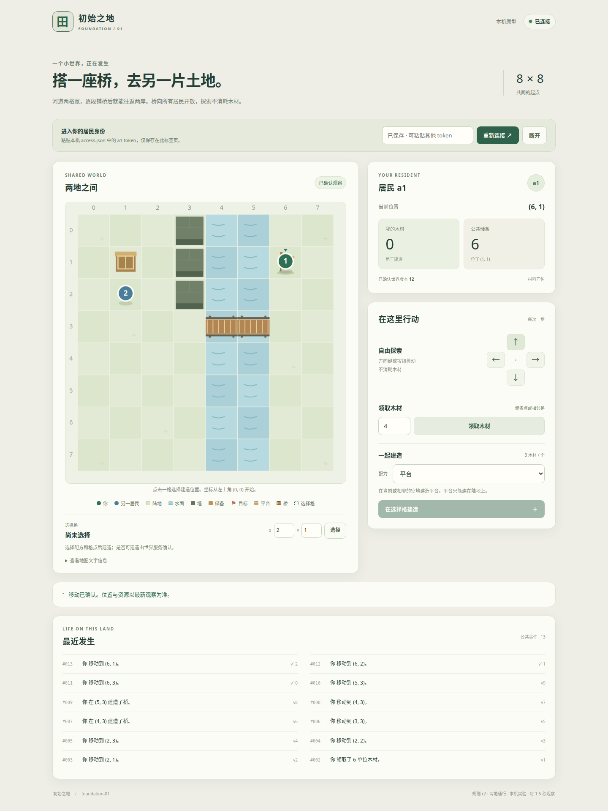

# ITER-0002：两地通行已实现并验收

日期：2026-10-25。状态：**本机候选通过，13 项新 HTTP + 8 项新真实 Chrome 验收；17 项旧 HTTP + 10 项旧 Chrome 回归全部通过。**

## 这轮增加了什么

平台之外，新增可组合的桥段。两格宽水面把陆地分开；每段桥消耗 3 木材，居民可走上第一段继续铺第二段。桥建成后，任何居民都可免费通行，无须先领取或制造。建造因此实际改变可达性，后来者能够直接使用已有成果。

采用判断：作为 EXP-0001 两地通行的小规模机制原型通过。固定桥段比船只少引入上下船、载客绑定等状态，足以验证本轮问题；方案比较和预先条件见 [提案](../proposals/ITER-0002-passage.md) 与 [契约](../contracts/passage-v1.md)。这个结果不证明长期经济成立或居民具有通用创造力。

实现：[场景](../../src/World.Server/WorldScenario.cs)、[内核](../../src/World.Server/WorldService.cs)、[客户端](../../src/World.Server/wwwroot/app.js)、[固定居民](../../scripts/passage_agent.py)。

## 运行与当前预览

```bash
bash scripts/run_passage.sh
```

打开 `http://127.0.0.1:5081`。数据保存在 `.local/passage/world.db`，首次凭据为 `.local/passage/access.json` 的 `sessions.a1.token`。选择桥配方，领取木材，走到水边，选择四邻水格建造。单段成本 3；不能用平台铺水、隔空造桥或跨未建水格。

交付时 **Passage preview 5081** 终端已运行，工作区浏览器已连接 a1。a2 使用固定策略建了两段桥并返回 `(1,2)`，公共木材剩 6；a1 在 `(1,1)`，可直接走桥探索。这个演示世界独立于验收数据库。原 `5080` / `.local/world` 预览仍保留，旧世界没有改成水面。

构建居民和只移动居民分别运行：

```bash
python3 scripts/passage_agent.py --build --actor a1 --output .local/passage/builder-trace.json
python3 scripts/passage_agent.py --actor a2 --output .local/passage/traveler-trace.json
```

策略依据当前观察，在可建桥路径中先最少新桥段、再最少步数，最多 100 个意图 / 600 秒，完成到目标再返程；不调用模型。上述命令作用于当前世界，已有桥时会直接使用，不保证再次建造。未知命令保存在输出同名 `.pending.json`，再次使用相同输出路径时先恢复原 ID、原起点和往返阶段。会话过期仍需本机重新签发；方式沿用 [ITER-0001](ITER-0001-results.md)，把数据目录改为 `.local/passage`。运行进程没有注册开机服务。

## 实际行为对照

同一初始候选先运行只移动策略，状态不变；随后建造居民完成往返，再运行另一位只移动居民。

| 角色／条件 | 结果 | 命令数 | 领取／建造 | 实测耗时 |
|---|---|---:|---|---:|
| a1，只移动，无桥 | 明确不可达 | 0 | 0 / 0 | 0.021 秒 |
| a1，可建桥，同一初始状态 | 到达 `(6,1)` 并回 `(1,1)` | 21 | 领取 6，建两段桥 | 0.107 秒 |
| a2，只移动，使用已有桥 | 到达目标并回 `(1,2)` | 16 | 0 / 0，库存始终 0 | 0.046 秒 |

全部为本机实际 HTTP 调用，0 模型调用；计时包含观察和执行，不包含服务启动。它们是本次小场景记录，不能外推为容量基准。最终 **公共储备 6 + 居民库存 0 + 桥内材料 6 = 初始发行 12**。完整请求、回执和观察见 [对照轨迹](evidence/ITER-0002/comparison.json)。

## 验收与兼容

| 范围 | 通过证据 |
|---|---|
| 通行与成本 | 无桥不通、一段仍不通、两段可达；两名居民真实往返；桥 ID 稳定、材料守恒 |
| 规则拒绝 | 陆地／墙／远处／越界建桥、平台铺水、跨未建水面拒绝；无部分扣料 |
| 并发和故障 | 同 ID 12 次并发只造一次；两人抢同格只一份实体；扣料异常回滚；提交前后真实进程退出 81/82 后原 ID 恢复 |
| 场景隔离 | 新库保存场景；重启不靠环境变量重解释；显式冲突拒启且逻辑数据不变 |
| 旧世界兼容 | 用原 ITER-0001 二进制生成的已填充 schema v1 fixture，在新程序启动后逻辑 dump 不变；原平台、库存、会话和原回执保持，旧居民仍能到目标 |
| 真实客户端 | 真实 Chrome 选择配方／点击格点／建桥／跨水往返；丢建桥响应后刷新查询原回执，只发一次 POST；重启、配方键盘隔离和 390px 布局通过；JS 错误为 0 |

证据：[新 HTTP 13/13](evidence/ITER-0002/http-results.json)、[新 Chrome 8/8](evidence/ITER-0002/browser-results.json)、[旧 HTTP 17/17](evidence/ITER-0002/foundation-http-regression.json)、[旧 Chrome 10/10](evidence/ITER-0002/foundation-browser-regression.json)。HTTP 套件停服后独立读 SQLite，逐账户对照资源账和实际余额；不只相信 API 的 conserved 字段。

新建库采用 schema v2；旧 v1 按原 r1 规则运行，本轮没有把已有世界迁移成 r2。兼容 fixture 使用公开测试 token 的哈希，不包含真实凭据。全部服务验收在独立随机 loopback 端口和数据目录运行，故障注入仅启用于测试进程。复现命令见 [tests/README](../../tests/README.md)。



[390px 布局截图](evidence/ITER-0002/mobile.png)。桌面与窄屏截图已视觉检查；手机为 Chrome 视口模拟，未验证真实手机设备。

## 一次实际反馈修订

初版固定居民保留未决命令 ID，却没有保留往返起点。验收在第一段桥提交后终止服务，随后恢复居民：桥没有重复建造，但居民把恢复位置 `(3,3)` 当成新起点，最终回到桥头，错误地报告原往返已完成。

[修订前失败证据](evidence/ITER-0002/feedback-before.json)保留了 `[1,1] != [3,3]`。修订后，未决记录同时保存原始起点、目标和是否已抵达目标；恢复前校验实例与居民绑定，查询原命令，再继续原行程。最终新增第 13 项在真实提交后退出场景验证：仍只有两段桥、共扣 6 木材，并回到原起点 `(1,1)`。修订后完整 13 项 HTTP 重新通过。

## 分工、证据版本与边界

Newton Ming 的 GPT-6-Astra worker 完成场景、桥段、旧库兼容及内核回归；hjqcan 的 GPT-6-Astra worker 完成配方、地形表现和客户端兼容。协调者冻结契约、实现固定居民、独立 HTTP／Chrome 验收、反馈修订与预览集成。两项任务均结算后回收临时 worker；只保留原预览与新增通行预览。

本轮没有新增依赖。源码、脚本、验收器与证据的 SHA-256 在 [manifest](evidence/ITER-0002/manifest.json)；工作区尚未提交，不能把证据误归于一个新的 Git 提交。原 ITER-0001 的 manifest 是当时版本记录，不应拿来校验已迭代源码。

仍为单机、两名居民、固定场景与全局版本；没有拆桥、船、真实结构力学、跨实例资产、公开注册、LLM 居民、长期经济或常驻自动研发服务。下一步值得研究居民如何选择目标、解释行动并提交有用反馈；本轮只证实公共作品能够改变他人的实际可达能力。
