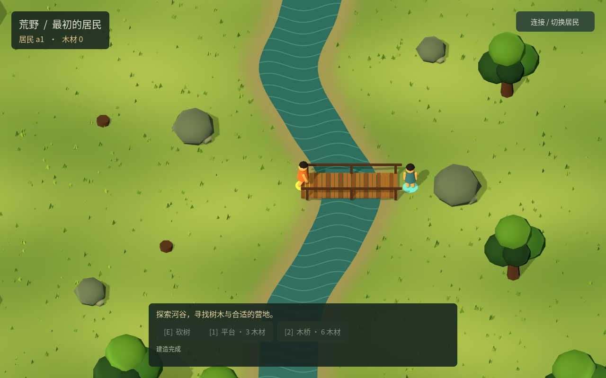

# ITER-0014 · 连续自然地图

2026-10-26。按用户要求替换棋盘地图和逐格行走。当前 Godot 原型使用32×24米自然河谷、连续实数位置、跟随镜头、键鼠自由行走、树冠拾取、采集反馈和占地建造预览。服务端裁决速度、碰撞、材料和完整木桥的通行。

## 运行与接口

`npm start` 启动 r8 服务，`npm run start:godot` 打开原生窗口。默认端口5089、数据 `.local/continuous`；另一居民使用 `WORLD_ACTOR=a2 npm run start:godot`。旧 r1—r7 数据保留；本轮新原型没有迁移旧世界。浏览器根页面说明原生入口，避免再显示旧棋盘。

- [连续坐标契约](../contracts/continuous-world-v1.md)：实数 `[x,z]`、`walk.to`、河道／岩石几何、树木、建造占地、完整桥面。
- [客户端操作与边界](../../clients/godot/README.md)：WASD、点击、E、1／2、Esc、恢复规则。
- 后端仍使用同一 HTTP 身份、命令 ID、版本检查、回执和事务账本。移动额度按服务端时间补充，轨迹分段检查所有碰撞交点，不只判断终点。

## 验收

全部实际运行，模型调用0；服务、数据库和故障代理均在隔离目录与随机本机端口，结束后关闭。

| 检查 | 结果 | 证据 |
|---|---:|---|
| 新 r8 HTTP | 12 / 12 | [结果](evidence/ITER-0014/http-continuous-results.json) |
| 真实 Godot / OpenGL | 9组 / 55项断言通过 | [结果](evidence/ITER-0014/godot-results.json) |
| 既有 r1—r7 HTTP | 154 / 154 | 本目录10份 `http-*-results.json` |
| .NET 构建 | 0警告、0错误 | 实际 `dotnet build --no-restore` |
| 本机原生窗口 | NVIDIA RTX 5070，连续采样60 FPS | [运行记录](evidence/ITER-0014/native-preview.json) |

HTTP 覆盖实数坐标与重启、斜向移动、树干／岩石／河岸／边界截停、高频请求限速、并发重放、过期版本、完整建造占地、采集故障原子性及双居民过桥。每个库停服后检查外键、资源总量12和事件／回执数量。

Godot 覆盖实际键鼠输入、无取整目标、树冠选择、E采集、平台预览、整桥建造与他人零材料复用，以及丢回包、客户端和服务重启、原请求重试、错误回执、过期观察和身份隔离。额外验证：按住移动键期间丢回包，自动查询确认后不会继续旧按键，释放并重新按下才恢复移动。

实际画面已逐张查看：[初始场景](evidence/ITER-0014/continuous-initial.png)、[平台](evidence/ITER-0014/continuous-platform.png)、[1024窗口](evidence/ITER-0014/continuous-compact.png)、[他人过桥](evidence/ITER-0014/continuous-shared-bridge.png)。

初轮失败也保留：[HTTP初轮](evidence/ITER-0014/initial-http.log) 的站位超过采集范围约1厘米，修正测试站位；[Godot初轮](evidence/ITER-0014/initial-godot-results.json) 的精确浮点比较改为数值容差。实机查看发现[地面背面剔除](evidence/ITER-0014/initial-terrain-missing.png)，修正三角面绕序；[建造键检查](evidence/ITER-0014/bridge-input-initial-results.json) 暴露轮询期间输入被忽略，现等待当前请求完成再处理明确输入。

## 范围

这是低多边形可玩原型，四棵资源树共12木材；点击路线直走，遇障碍停止，尚无自动绕障碍、生态再生、工具制作或精细骨骼资产。本轮没有运行真实模型居民或验证长期玩法。

Python Agent、报告查看器及 ITER-0013／0015 由同工作区另一会话负责，本提交不包含这些文件。工作区额外13项旧居民任务HTTP也曾通过，但不计入本提交的154项旧场景结果；另一会话的178 HTTP／126 Chrome属于其独立报告。

使用用户提供的 [Godot游戏开发技能](https://github.com/gamedev-skills/awesome-gamedev-agent-skills) 的3D场景、物理和镜头指导；[Sac工作流](https://x.com/Saccc_c/status/2110694725640474759) 用作场景与角色分工、统一风格和实机多角度检查的参考。保持 Godot → Unreal 路线，未导入参考游戏资产或调用其付费模型服务。
