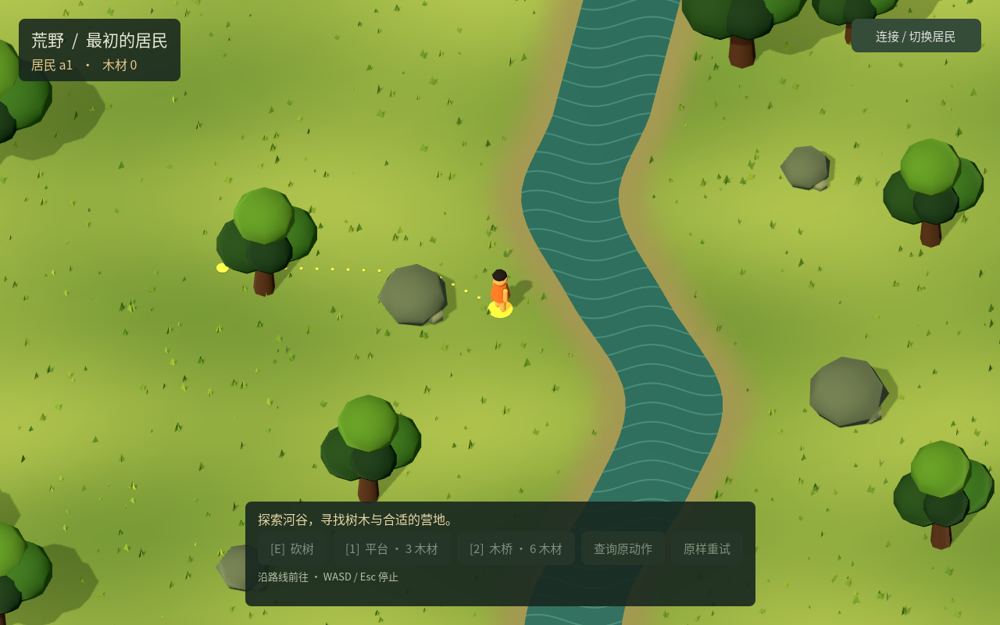

# ITER-0016 · Godot 点击绕障与过桥

2026-10-26。点击地面后，居民沿路线绕开树木、岩石和河道；已建木桥连通两岸后，双方都可自动经桥前往远处。点击树冠会走到采集范围，WASD 继续直接控制。无法到达的目标会提示，且不发送移动命令。

## 行为与实现

路径以细点显示，目的地保留标记；新点击替换旧路线，WASD、Esc、切换连接、应用失焦和不确定动作停止路线。取消也会作废等待 HTTP 的旧点击，丢回包经原命令回执查询恢复后不会自动继续行走。

`world_navigation.gd` 使用 [Godot 导航服务](https://docs.godotengine.org/en/stable/classes/class_navigationserver3d.html)，依据 r8 观察异步生成导航网格，等待区域和地图均同步后查询路径。树木尚未采空时不重建；树采空或桥建成时更新，普通移动和库存变化复用网格。河道先按角色占地扩张，再扣除桥面内侧可行走区域；树石外轮廓保留小量余量。使用引擎的[路径简化](https://docs.godotengine.org/en/stable/classes/class_navigationpathqueryparameters3d.html)，保留必要转角。

导航只决定下一步意图，坐标、速度、碰撞和材料仍由服务端确认。若服务端返回受阻或不确定结果，客户端停下；不修改实体位置或编造到达事实。地图边缘可将点击点调整到相距不超过22厘米的可行走位置，并用实际目的地标记显示。

## 实际验收

| 检查 | 结果 | 证据 |
|---|---:|---|
| 新导航真实 Godot/OpenGL | 5组、42项断言通过 | [完整结果](evidence/ITER-0016/navigation-results.json) |
| 原采集、建造与恢复 Godot 回归 | 9组、56项断言通过 | [完整结果](evidence/ITER-0016/regression-results.json) |
| 路径与停止状态 | 所有受测导航步均无碰撞截停 | 本目录5份 `*-paths.json` |
| 停服后的 SQLite 审计 | 外键有效、木材总量12 | [审计](evidence/ITER-0016/database-audit.json) |

新增场景覆盖实际鼠标绕树／绕石、行走不重复烘焙、无桥不可达且不发命令、树采空后直接穿行、使用采集到的6木材建桥、双方零余料经桥前往远处、延迟请求期间取消和最后一次点击生效，以及丢回包后查询原回执并由新点击重新出发。实际截图另见[建设者到达](evidence/ITER-0016/crossed.png)和[另一居民复用](evidence/ITER-0016/reused.png)。

原9组回归覆盖真实键鼠采集建造、点击树冠、1024窗口、完整桥面、按住移动键时丢回包、提交前／后丢回包并重启、错误回执、过期观察、离线和损坏恢复记录。本轮所有自动验收使用独立目录、随机本机端口和实际 Mesa OpenGL 渲染，结束后关闭自启测试服务。模型调用0；未运行新的 HTTP 专项、Chrome 或真人体验验收。

初轮测试出现假阳性：直接调用 `connect_world(a2)` 时恰逢轮询忙，请求被忽略；随后仍由 a1 过桥，测试只检查位置和材料而漏查身份。[初轮结果](evidence/ITER-0016/initial-navigation-results.json)中的双居民结论已撤回，[原截图](evidence/ITER-0016/initial-reuse-wrong-actor.png)及[初轮身份审计](evidence/ITER-0016/initial-identity-audit.json)均证明新导航场景中的 a2 未行动。旧回归当次确有 a2 行动，但同样缺少身份断言。连接按钮现等候当前 HTTP 完成；新旧过桥测试均明确断言 a2 身份，新导航还核对双方最终坐标与 a2 原回执。

检查画面还发现，先点不可达位置、再点可达位置时，旧提示会短暂保留。已在有效路线开始时更新提示，并另跑一次鼠标绕障场景和截图复核；[复核结果](evidence/ITER-0016/ui-refresh-results.json)不重复计入上表。源码、测试与公开证据哈希见 [manifest](evidence/ITER-0016/manifest.json)。

复现：`python3 tests/godot_navigation.py`；原回归：`python3 tests/continuous_godot.py`。运行前使用项目现有构建产物与 Godot 4.7.2；也可设置 `GODOT_BIN`。

## 协作与边界

本轮只修改 Godot 导航／场景交互及专属测试文档，没有修改 C#、Python 任务执行器、报告页或公共测试入口。ITER-0017 的明确建造任务由另一会话负责。主目录构建会话负责共享恢复记录、连接代际和 ITER-0018 世界实例绑定；合入连接代际分支时须调用 `_stop_walk()`，并使新观察进入 `navigation.update_geometry()`。本报告证明当前导航候选，不代替这些后续合入的独立验收。

当前仍是小型连续河谷原型，没有导航动态居民碰撞、生态再生或大地图性能结论；角色间通行沿用现有服务规则。默认预览服务及已有原生窗口未在本轮重启。
