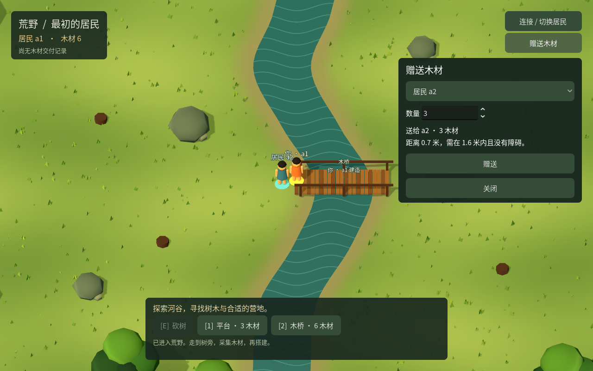
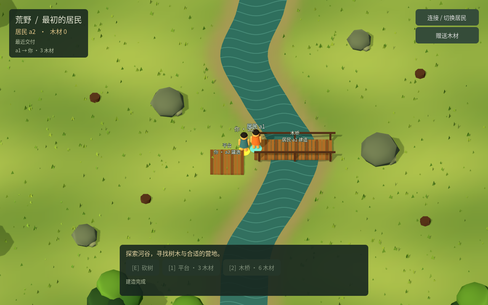

# ITER-0020 · 自愿赠送与合作建设

2026-10-26。独立 `wilderness-cooperation-v1 / r9 / schema 9` 已实现当面赠送木材：持有者明确选择收件人和数量，接收者收到材料后可建自己的平台。Godot 人类入口、Python 有界任务、原命令恢复和只读报告均已接入。旧 r1—r8 世界保持原规则，不自动迁移；默认 `npm start` 仍是 r8。

本轮采用自愿合作能力。**持有者拒绝赠送时，后来者仍可能没有独立建造材料；C16—C17 的入口与先发优势问题尚未解决。** 世界仍是四棵树、初始12木材，没有再生、免费补料、交易价格或预约机制。

## 运行与实际流程

```bash
npm run start:cooperation
# 另开终端
npm run start:godot:cooperation
# 或接收者
WORLD_ACTOR=a2 npm run start:godot:cooperation
```

新入口默认5090、`.local/cooperation`；人类在右侧打开“赠送木材”，选择另一位居民及1—12数量。双方必须相距不超过1.6米，站点与完整角色半径扫掠路径可通行。接收者不需要提交接受命令，不产生债务或回报义务。旧二进制与 r9 记录共用恢复根不在兼容承诺内；新入口使用独立 `user://cooperation-pending.json`，不清空原记录。

[三段固定策略示例](../../examples/cooperation/README.md)使用真实 `run_resident.py --fixed-reference`：

| 阶段 | 实际结果 | 命令／木材支出 |
|---|---|---|
| a1 从零库存出发 | 西岸采6→建桥→东岸采3→赠送 a2 三木→返回 `[5,7]` | 98／9 |
| a2 建自己的平台 | 不采集，用收到的3木建 `[28,16]` 平台，返回 `[26,17]` | 9／3 |
| a1 访问该平台 | 只走已有通路，到达后返回 | 88／0 |

[构建者CLI自检22项](evidence/ITER-0020/cli-self-check.json)与[停服SQLite审计](evidence/ITER-0020/cli-audit.json)确认：最终自然3、双方库存0、桥6、平台3，总12；195份回执、196条事件、唯一一笔赠送；三份已完成任务再次读取，报告和世界均不变。实际模型调用0，三次固定目标选择仍记录在历史字段 `budget.used.modelCalls`，不把它解释为外部模型调用。此为示例作者自检，独立验收另列。

服务端另有“合法采完12→桥6→赠送3→a2平台3”对照：最后自然0、a1库存3、a2库存0、实体9。没有赠送的等价世界中，a2可过桥却不能造平台；不会把通行成功记作材料入口已解决。

## 已采用契约

完整字段见[材料转让 v1](../contracts/material-transfer-v1.md)。认证决定发送者，原实例、命令ID、收件人、数量与前置模式共同绑定请求。扣发送者、加接收者、世界事件、资源账和发送者私有回执在同一事务提交；收件人之后花掉材料，不改变原赠送成功事实。重复原请求只返回原回执。

转入也使接收者此前的 `actor-state-v1` 意图失效，覆盖 walk/gather/build/transfer。Godot 停止旧点击路线与持键，Python 停止当前任务；新输入才能继续。旧预算、起点、已完成事实和未决请求保留。旧严格请求、r8 原请求和回执保持原语义。

Agent 必须显式 `allowTransfer=true`，收件人、数量和会面点在任务中冻结。建桥、采集与赠送分别授权，总木材支出包含桥和赠送；桥前只需筹足当前桥梁材料，不能要求先持有隔河尚不可取得的赠送材料。接收者离开固定会面范围时停止，不自动追逐。

恢复前核对原权限、数量、模式、库存和会面事实；损坏记录在联网前拒绝。回执还必须匹配原规则、实例、身份、执行版本与精确扣减，缺失证据保留 pending。界面区分赠送、收到、后续建造；本人最近20条相关交付标明截断，完整历史仍经原事件接口读取。

## 作者回归

| 范围 | 结果 | 证据 |
|---|---|---|
| 服务端合作／拒绝合作、非法字段、交付几何、身份、并发、四类入账失效、三类故障、原回执及历史截断 | 9项通过 | [HTTP](evidence/ITER-0020/self-api.json) |
| Python 实际送达与接收者建造、授权预算、丢响应、原ID、损坏记录、换库隔离及零库存初态 | 10项通过 | [任务](evidence/ITER-0020/self-python.json) |
| Godot 真实UI、入账停止、损坏回执、提交前后进程退出恢复 | 5组35断言通过 | [原生](evidence/ITER-0020/self-godot.json) |
| Chrome 真实报告、坏证据、自赠／会面点矛盾、旧报告、390px、零世界请求 | 11项通过 | [报告页](evidence/ITER-0020/self-browser.json) |

完整普通回归为[257项 HTTP／SQLite、154项 Chrome](evidence/ITER-0020/full-regression.json)。[完整运行](evidence/ITER-0020/full-regression-initial.json)一次通过257／153；之后会面点与预算标签修正只复跑受影响的报告套件，以最终11项替换原10项，不冒称同一次执行覆盖最终全部源码。

[Godot组合41组630断言](evidence/ITER-0020/godot-regression.json)包含六套旧回归与新增转让套件。旧595断言全部重跑通过；新套件保留最初夹具失败，专项修复复验后汇总。全部使用隔离 `.local` 世界、随机回环端口，实际模型调用0。

## 独立验收

测试 Agent 使用独立源码／DLL副本及真实进程，未用SQL准备居民库存或建筑。

- [服务端](evidence/ITER-0020/independent-api.json)及[边界](evidence/ITER-0020/independent-boundaries.json)：自然采木到双方合作，拒绝合作，四类旧意图失效、双花竞争、原ID与历史成功、真实故障路径；1.5／1.6米可交付，1.601米及隔岩拒绝；换实例412无效果，旧r8数据、schema和原回执字节不变。
- [Python原回执15例](evidence/ITER-0020/independent-python-receipts.json)、[恢复预检15种损坏](evidence/ITER-0020/independent-python-preflight.json)及[三组控制流程](evidence/ITER-0020/independent-python-controls.json)：保留原请求、原预算、原身份，缺失／矛盾证据不结清；有效原请求只产生一笔材料效果；入账停止后再次读取零网络。
- [Godot原回执15例](evidence/ITER-0020/independent-godot-receipts.json)、[最终预检](evidence/ITER-0020/independent-godot-preflight.json)与[三组实际渲染](evidence/ITER-0020/independent-godot-ui.json)：13种坏本地记录在零命令请求下保留原文件；有效原记录原ID／原body恢复。鼠标打开面板、键盘输入数量、鼠标赠送；切换a2看到来源，实际点击建平台。持键和鼠标路线在入账失效后等待0.8秒无续跑，显式新输入可继续。
- [初态独立三组](evidence/ITER-0020/independent-planning.json)：无路、预算8都在零POST下停止；预算9完成98命令采集／建桥／赠送往返。研究方另有[五例修复前后对照](evidence/ITER-0020/research-initial-mission.json)及[只读审计](evidence/ITER-0020/research-initial-mission-audit.json)，没有把后来新增的恢复预检混算为该旧快照覆盖。
- 报告页[初次九项自动检查](evidence/ITER-0020/independent-browser-initial.json)通过后，目视另发现预算标签遗漏；[最终五项独立复验](evidence/ITER-0020/independent-browser-final.json)确认纯赠送3／3与桥加赠送9／9均正确标为材料支出，接收者390px入账／建造分列，旧报告可读，世界请求与JS错误均为0。





## 发现与修订

1. 研究方复现无路成本 `None+3` 异常，以及桥前强求9木导致原始初态误判缺料。已保留结构化无路结果，并区分当前筹料阶段和累计支出；前后真实任务证据见上表及[采用审查](../research/2026-10-26-continuous/13-transfer-adoption-review.md)。
2. 独立[Python初次预检](evidence/ITER-0020/independent-python-preflight-initial.json)发现两项漏检：原库存小于赠送额仍联网，以及篡改会面位置可进入错误事实。新增原库存／步骤／会面点预检后，原两反例与15种损坏全部在联网前拒绝，原文件不变。Godot也补了冻结库存必须足额的核验。
3. 只读报告接受了同时篡改目标、步骤和事实的自赠，另接受了步骤与事实同时偏离会面点。现在禁止自赠，并要求赠送位置符合冻结目标的到达容差；保留[自赠初次反例](evidence/ITER-0020/research-report-self-gift-initial.json)、[自赠独立复验](evidence/ITER-0020/research-report-self-gift.json)、[会面点初次反例](evidence/ITER-0020/research-report-meeting-initial.json)及[会面点独立复验](evidence/ITER-0020/research-report-meeting.json)。原报告仍可读，错误位置降为待复核；服务端未发生这些合成交易，页面没有世界请求。
4. 独立目视发现报告预算仍标“建造木材”，会把纯赠送支出误写成建造消耗。现为“木材支出”，说明含建造与赠送；事实区仍分别显示。

[Godot作者首轮](evidence/ITER-0020/self-godot-initial.json)和[二次UI](evidence/ITER-0020/self-godot-ui-second.json)失败来自测试未先更新鼠标位置、未等待观察刷新帧及连接后没有释放按键；修复输入夹具后真实操作通过。[独立UI首轮](evidence/ITER-0020/independent-godot-ui-initial.json)另有SpinBox焦点帧问题，补等待后通过。没有为测试放松产品校验。

[独立边界首轮](evidence/ITER-0020/independent-boundaries-initial.json)的审计列名错误、[独立初态首轮](evidence/ITER-0020/independent-planning-initial.json)的选择器不接收不可达目标，以及[CLI首轮](evidence/ITER-0020/cli-self-check-initial.json)把固定选择预算误认为外部模型调用，均保留原失败；修正各自夹具后复验，不计作产品修复。

## 来源与剩余边界

服务核心独立验收最初运行DLL `28da17e2...273534`；随后只有 `Program.cs` 的r9首页启动说明变化，最终DLL为 `61b48549...112e4`。最终DLL另实际通过独立Godot损坏记录／恢复和r8/r9首页检查。示例构建者使用自己的源码副本编译，DLL `c8841799...740ef3`；这些二进制分别记录，不把源码相同当成每个二进制都重跑完整验收。

[独立源码审计](evidence/ITER-0020/independent-source-audit.json)核对40个最终文件，其中39个匹配独立快照，唯一 `check.py` 差异是增加三项套件入口。冻结源码、公开证据与最终运行核对见[交付清单](evidence/ITER-0020/manifest.json)，原始来源见[证据索引](evidence/ITER-0020/evidence-sources.json)。[进程检查](evidence/ITER-0020/process-audit.json)确认测试服务已退出。访问文件、任务私有绑定、数据库及凭据不进入Git。旧持久预览没有重建、部署或迁移。

转让只有自愿持有者合作时有效；同一 `local-operator` 下的两个居民不是独立控制主体公平实验。只读报告核对文件内部事实与规则，不向世界重新验真。未验证长期资源来源、无限并发、公平调度、公众部署、真人体验或自主文明。持续建设目标仍未完成，下一轮需继续依据研究验证材料入口与发展机制。
