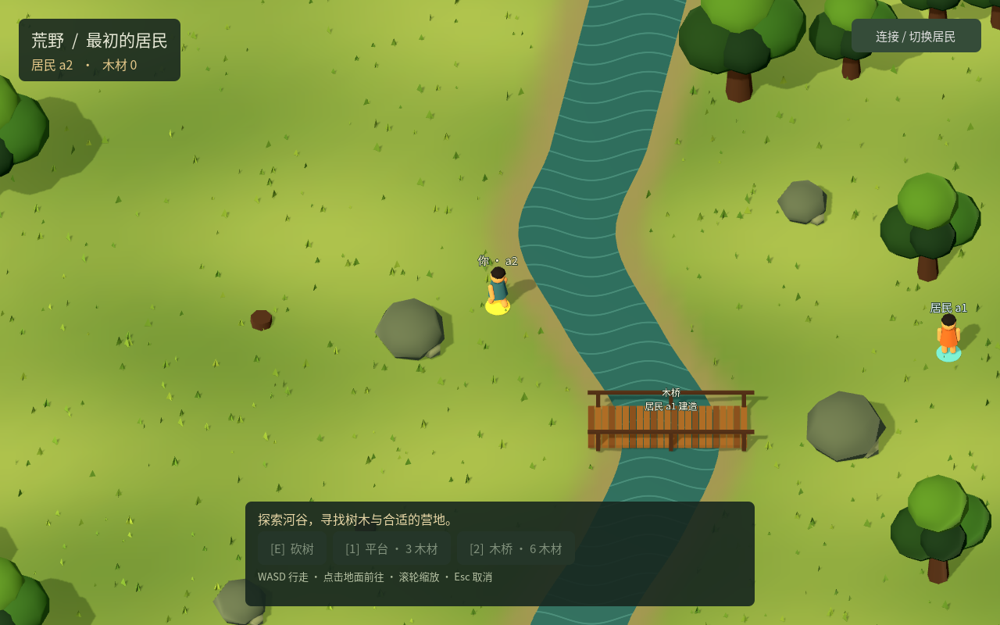

# ITER-0021 · 居民身份与设施署名

2026-10-26。Godot 现在明确显示“你 · a1 / a2”和其他居民 ID，平台与木桥标注真实建造者。修复切换居民后“自己”的脚下圆环仍留在旧角色上的问题；另一居民使用作品时不会改变署名。

## 行为与实现

身份来自已经验证的观察，不推断在线状态或人类／Agent 控制类型。当前 r8 设施的 `ownerActorId` 是创建时记录的建造者，展示它不增加所有权转让、私人占地或访问限制。

每次观察更新角色名称和自己的圆环；持续移动保留同一个视觉角色并插值到服务端确认的位置。连接代际变化或实例变化时清除旧角色、设施、地形、路线、建造预览和采集浮字，从新观察直接建立画面，避免同居民、同版本重连继续显示旧坐标或旧作品。原命令、认证、世界实例与恢复存储未改变。

文字使用系统中文字体和面向相机的 `Label3D`；绘制优先级让身份文字不被半透明树冠覆盖。引擎属性依据 [Godot Label3D 官方文档](https://docs.godotengine.org/en/stable/classes/class_label3d.html)。

## 验证

本表是构建作者自测，不计作另一批 Agent 的独立验收。全部使用隔离 `.local` 数据、随机回环端口、实际 .NET/SQLite 服务及 Xvfb/OpenGL Godot 渲染进程；真实模型调用0。

| 检查 | 结果 | 证据 |
|---|---:|---|
| 身份、真实采集建造、连接切换、视觉基线 | 1组、27断言通过 | [原始结果与源码哈希](evidence/ITER-0021/attribution.json) |
| 原有输入、采集、建桥与原命令恢复 | 9组、56断言通过 | [回归结果](evidence/ITER-0021/continuous-regression.json) |
| 绕障、树木变化、双居民过桥、取消与丢响应 | 5组、42断言通过 | [回归结果](evidence/ITER-0021/navigation-regression.json) |

合计15组、125个断言。14组既有回归在最终两行标签绘制优先级调整前通过；调整后重跑全部27项新场景，并重新查看实际渲染截图。未因这一纯绘制调整重复运行服务端和浏览器全量回归。

新场景由 a1 合法采集3木建成平台，再实际认证切换到 a2，由 a2 合法采集并建成自己的平台。停服后，两实体分别属于 a1/a2，各有匹配原命令回执、各承载3木；自然、库存与实体合计仍为12。随后同一 a2 连接另一持久世界，替换世界保持0回执、0作品、12自然木材，画面不再含旧平台或浮字。全部自启测试服务已停止。

截图：[第一居民及其平台](evidence/ITER-0021/first-resident.png)、[第二居民及其平台](evidence/ITER-0021/second-resident.png)、[同居民换到新世界](evidence/ITER-0021/replacement-world.png)。桥梁回归截图同时呈现 a2 的自己标记、a1 的其他居民标记及 a1 的桥署名；对应测试还核对实际 a2 认证、坐标和数据库回执。

并行检查时新增探针曾在后台轮询期间直接调用底层 `send_action`，该调用因忙碌被忽略，后续采集正确遭到距离拒绝。保留[初次失败](evidence/ITER-0021/initial-probe-failure.json)。探针已改为等待空闲，并逐条要求新的已提交回执；未更改产品的原命令或忙碌语义。

基线为 `8aadf53`。本轮产品改动仅 `world_view.gd` 和 `main.gd` 的一次视图更新调用；[清单](evidence/ITER-0021/manifest.json)记录最终源码及证据摘要。现有预览未重启，正在并行研发的 ITER-0019 并发条件和 ITER-0020 材料转让草案不属于本轮已验收能力。

复现：`python3 tests/godot_attribution.py`。Godot 位置可通过 `GODOT_BIN` 指定；新测试尚未由本分支修改共享 `package.json` 入口，集成时由该文件维护者接入。
