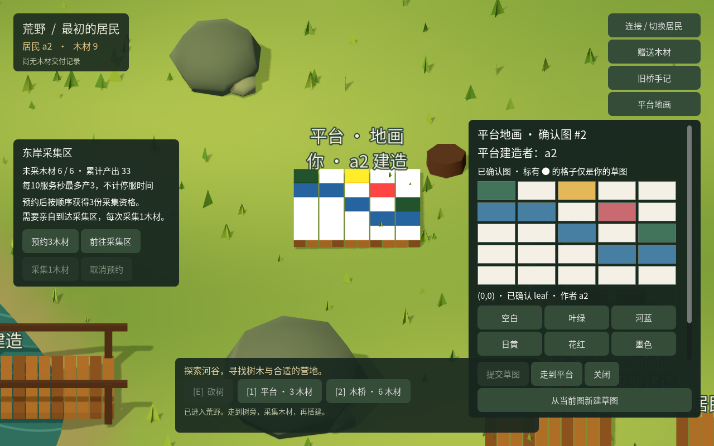

# ITER-0025 · 原平台上的共同地画

2026-10-26。本轮本机原型实现与独立验收完成：原持续世界的平台已有两人接绘的9格地画，Godot直接显示原平台表面。采用[研究17](../research/2026-10-26-continuous/17-space-after-continuous-materials.md)、[采用前复核18](../research/2026-10-26-continuous/18-platform-canvas-adoption-review.md)和[entity-canvas-v1契约](../contracts/entity-canvas-v1.md)。全部活动为明确固定输入或故障探针，真实模型调用0；本轮没有公共部署。

## 产品变化

原地图仍有可建位置，因此本轮先给已有平台增加可见用途。在同一持续材料实例的原平台显式开放5×5、6色地画，居民可在现场画无人署名格或本人格。每次提交1—8格，携带原平台、能力版本和地画revision；整批原子成功或拒绝。同控制组、平台建造者或空白颜色均不授予覆盖他人格的权利。绘制不花木材、不产生新实体，后台正常生产单独记账。

Godot把已确认格子直接画在原平台表面；点击平台或侧栏入口打开网格，分别显示建造者和格子最后作者。草图有独立标记，关闭不发送，明确提交后才成为世界内容。别人改图后保留原草图并要求明确新建，不自动追新revision。Python沿现有任务执行器使用明确固定patch、原起点、原实例及累计预算；报告页分别显示本次原修改、最后观察到的图和往返结果。

## 同一原历史的实际接续

起点沿用ITER-0024最终自然史：实例`w_15ced6889f624d8da8a3d2129ba26874`，state754、736回执、755事件，六个实体、两条旧桥手记。目标是a2此前实际建造的平台`e926486325c2c4e3e924610139ee26711`，位置`[24,7]`、含木3；没有重造平台或更换实例。

独立自然活动在core-v1上显式采用地画后，a1_alias实际走到平台画5格河蓝，并返回原起点；a2先读取这幅已确认图，再到现场在4个空格接绘并返回。298条请求为296次行走及2次绘制，未直接改SQL资源、位置或时钟。

| 原修改 | 居民 | 版本／游标 | 事实 |
|---|---|---|---|
| `ee3c85a5d0f74313bf703a35301faa0e` | a1_alias | state866／event867，地画revision1 | 5格，提交时库存0 |
| `7590f71def004084ad8f7685fe496a77` | a2 | state1014／event1015，地画revision2 | 4格，提交时库存9、支出0 |

最终自然史state1054、1034回执、1055事件，原736回执与755事件全部保持；六实体和两手记不变。正常来源生产另增3木，累计生产30→33，总投入45=私人库存18+实体21+来源6。a1仍有原6木。a1_alias属于a1的声明控制组，不能称为新的现实独立主体。

core-v2的独立修复验收使用这条合法自然史的副本，核对两份原edit／事件、原ID回执字节和资源账，重启后9格仍在；没有重新执行双人旅程。独立Godot从这条历史的停服三阶段副本读取，实际显示空白→5格→9格，无paint／walk POST。另有原生鼠标编辑支路与Python CLI支路，均单独记账，不能拼成同一自然时间线。



图来自最终native-v3的只读补证：关闭相机自动跟随，将镜头对准原平台；5次GET、0次POST，三份原阶段文件指纹不变。空白、第一幅、两人图与实际悬停作者截图均已目检，不能把调整取景记成居民移动。

## 原请求与兼容

离线采用只允许原r10持续材料世界由存储11显式升为12；不自动采用所有平台。原回执、平台身份、建造者、木材、手记和材料政策保持，重复采用不加事件。未采用的旧世界行为不变；旧服务冷启动拒绝存储12。

本次绘制完成须核对原回执、按实体／作者／命令精确读取的不可变edit，以及原事件。当前图后来变化、原edit掉出最近50条、最后观察早于已确认修改，都不抹掉原成功。原始请求使用同一ID/body恢复，404才可能原样重试；503、错实例或证据不齐保留未决。自己的后来动作发生后，旧任务可确认早先绘制，却仍须停止旧返程，不能刷新旧前置状态绕开`STALE_ACTOR_STATE`。

Godot新绘制使用恢复记录5，旧动作仍沿原格式。新版保留旧记录处理；旧程序保留未知记录并暂停。未知当前地画能力不授权新绘制，但仍能核对原成功；切换世界后原地画未决也应在异实例提示中可见。

Python查询在I/O前扣额，首次失败、原回执、原edit与原事件查询均计入，恢复不补额度。实际queries=3可出现已提交但证据未齐、仍保留pending；queries=4可确认原修改，但下次观察已无预算，仍显示预算耗尽，返回状态按实际起点与位置单独记录。此时最后观察的图可能仍是revision0，不能伪造一份绘制后的快照。报告页只核对文件内部一致性，不重新认证在线世界，公开报告也不包含所有失败查询日志。

## 已发现并修正的问题

- 独立QA把隔离副本的一条edit库存改为SQLite REAL `0.5`，core-v1通过`GetInt64`截成0后错误接受。core-v2在转换前要求实际整数类型，覆盖采用、修改和格子字段。作者12列反例和独立原反例／3列补充拒绝检查均通过，合法原自然史可继续读取。
- 原生首次提交按钮藏在滚动内容底部，鼠标测试实际未发送。改为固定操作按钮后通过；确认后的悬停文字也清除旧草图标签，色板使用实际鼠标操作复验。
- 报告页补齐预算与步骤数／必要查询／上限的一致性检查、缺少当前图时保留原成功、未排序原请求与规范edit的语义比较。预算矛盾降级整体完成，不擦除已核对的原修改。
- 原生可选能力校验曾阻断重启加载旧pending；改为在新绘制入口校验能力。异实例提示补入记录5；实际Godot探针证实JSON数字为float、数组成员判断区分数值类型，最终沿原数值相等判断兼容2—5。

测试驱动的路径、JSON数字类型、过强终态文本／秒数冻结等失败与上述产品缺陷分开保留。后续版本不改写前一份结果或二进制归属。

## 运行方式

对自己的已停止服务、已采用持续材料的原r10世界，使用实际观察中的实例与平台ID：

```bash
WORLD_DATA_DIR="$PWD/.local/material-access" \
  dotnet src/World.Server/bin/Debug/net10.0/World.Server.dll \
  adopt-entity-canvas --instance <原world.instanceId> --entity <原平台entityId>
npm run start:material-access
WORLD_ACTOR=a2 npm run start:godot:material-access
```

不另换数据目录或恢复记录前缀来绕开旧未决。`tests/fixtures/entity-canvas-first.json`和`entity-canvas-second.json`是本轮原平台的固定参考任务；实际使用须明确自己的原平台、当前revision和patch，再沿`run_resident.py`保存／恢复同一任务。第二份任务须基于确实读到的第一幅图，不能盲用示例revision。

## 验证与剩余边界

原始结果、初次失败、截图和逐文件SHA-256见[证据目录](evidence/ITER-0025/README.md)，[覆盖表](evidence/ITER-0025/coverage.json)逐套列出计数和原报告。作者自检、worker交付与独立执行分列如下。

| 范围 | 实际结果 |
|---|---|
| 作者HTTP／Python组合 | 29套共333项：332通过、1跳过；本轮新增服务9组、Python8组全部通过。跳过的是旧手记任务的实际旧服务探针，因本次未提供`ENTITY_NOTES_OLD_DLL`，不记为通过。restore／build及全部套件进程退出0。 |
| 作者Chrome组合 | 20套共199项通过，其中本轮19项使用默认入口实际生成的报告；无世界API请求及脚本错误。 |
| 作者Godot组合 | 11套、67组、902断言通过。运行期间两处原生产品代码修正，聚合`sourceUnchanged=false`如实保留；最终地画7组88断言使用native-v3，`sourceUnchanged=true`。不把早期旧套件改记为全部在最终版本运行。 |
| Python worker交付与审查 | 8组自检及7文件交付指纹；4个产品脚本、2份固定输入保持。协调者随后只改测试驱动的默认基线取得方式；最终8组默认入口通过，worker另作只读核对，不能计为独立执行。 |
| 独立核心 | core-v1原自然活动、采用矩阵、并发与原子批次、提交故障／精确历史；core-v2原整数损坏反例及补充字段拒绝、合法原自然史读取复核。保留v1失败，不重演原旅程。 |
| 独立Python | 5组：真实CLI、首次查询失败、进程退出／原请求恢复与超过50条历史、7类实际HTTP证据失败、queries3／4预算分界。部分早期整run为false，只接受其中明确已完成组及后续复验。 |
| 独立Godot | 6组按native-v1／v2／v3分列：原阶段、实际鼠标编辑、恢复、坏证据、真实旧记录4、缺失／未知能力与异实例记录5；另有最终v3只读三阶段39项补证。 |
| 独立Chrome | web-v1共13项、11类坏报告、实际独立报告及390px布局通过，0世界API请求。旧12项报告中一处标题不精确，保留原文件；13项明确区分真实旧快照与合成新图反例。 |

最终核心DLL为`5f9426ac1df94cab856262688d02ab6265096bfb74f18747fd39e443b2f3e1de`。[源码核对](evidence/ITER-0025/final-source-audit.json)确认核心17文件、native-v3的14文件、Web8文件均匹配冻结版本。组合期间除上述两处原生修正外，变化只有相关Godot测试和浏览器生成器超时清理；核心、Python产品及Web产品未改变。

按用户要求，已删除本轮完成的作者临时数据库214,320,896字节、独立客户端副本47,972,696字节，组合入口另清理临时二进制54,749,803逻辑字节。原自然头、三阶段、失败与核心损坏反例、报告和截图保留；清理前确认文件未被进程打开，保留文件指纹不变，测试服务均已退出。源码回归测试继续保留。

本轮未扩地图、未拆除回收、未开放更多平台、未移植覆盖审批。25格可被先占，本人重画不等于后来者总有位置；固定接绘成功不证明真人觉得好玩或形成社会关系。C16—C17、长期经济、现实独立身份和持续创作空间仍未关闭。
