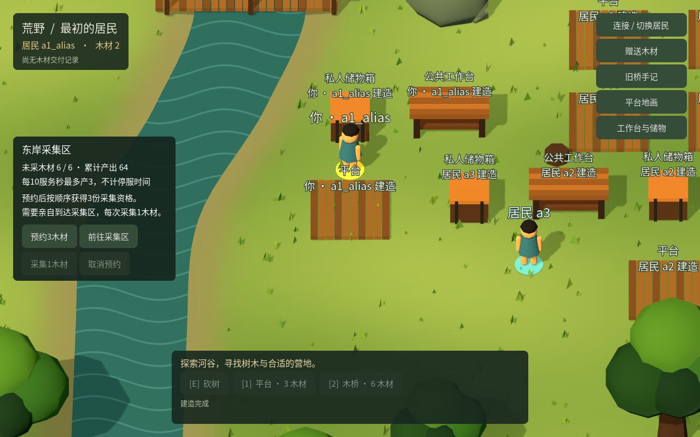

# ITER-0027 工作台、木工锤与持久储物

2026-10-26。已实现并完成分列验收，采用范围为本机候选。

按用户要求和[研究20](../research/2026-10-26-continuous/20-workbench-and-tools.md)，采用[工作坊契约](../contracts/workshop-v1.md)：3木搭公共台，1木制作本人持久木工锤，3木和本人锤搭私人箱，实际存取并用于后续建造。台、工具、箱内木材进入同一权威材料账；箱子容量12，个人携带上限仍为12。参数为本轮实验选择。

## 实现与边界

服务增加四种动作及不可变原动作明细，存取与扣料、产物、事件、回执在同一事务提交。公共台使用者消费本人的材料，台主不必在线；箱内内容只允许箱主存取。工具1木、箱内木材和建筑用材分账守恒。所有家具形状公开，但个人工具与逐箱内容明细按本人读取；公开资源汇总仍可能推断单箱内容，不宣称完整信息保密。

原持续材料r10仅在停服后显式采用存储13；保留原实例、来源相位、物资、作品、手记、地画和回执。旧客户端缺少家具能力声明时暂停，新版沿原命令恢复；已有回执优先于当前条件，旧动作规范化不变。未采用世界不自动升级。

Godot显示实际桌面、桌腿、箱盖和署名，面板支持选台、制锤、选本人锤放置箱子，以及明确数量存取。家具参与行走碰撞；接近点必须可到达且交互直线无水或其他障碍。原生恢复记录6核对原回执、事件和详情，后来的箱余额不替代原动作事实。

Python[固定任务](../contracts/workshop-mission-v1.md)每次冻结一个明确动作、实例、居民、台／工具／箱与坐标。四个独立权限不扩大旧建造权；原命令、查询与时间预算跨重启累计。报告区分配方用材与存取周转，以及原动作完成和返程完成。没有模型选择、自动补料或换目标重试。

## 验收记录

| 范围 | 已完成结果 | 证据性质 |
|---|---|---|
| 独立HTTP／SQLite | 覆盖18个不同组；v1的16组与v2的6项定向复验共22次成功运行 | 独立QA2，另保留v1缺画布历史的失败反例；不是18项全部在v2重跑 |
| 原生原命令恢复 | 8项通过，加修正建台夹具后1项复验，共9种情形、122断言 | 作者真实HTTP／Godot headless／磁盘／进程重启；独立QA2只读核对，非另一次执行 |
| 桥边交互反例 | 原点在1.25米内但交互穿水；修复后换侧，实际Godot路径及C#逐段扫掠通过 | 作者9项几何检查与研究者独立运行；合成台夹具，0世界动作 |
| 旧行为定向回归 | 连续地图12、按居民状态10、旧地画存储3，共25项通过 | 作者；本轮没有重跑全部历史套件 |
| 旧原生导航 | 5组42断言通过 | 作者真实Godot／HTTP，涵盖障碍、树状态、桥、取消与丢响应 |
| Python固定任务 | 覆盖25个不同组：20组全测、观察截止修复后9项、终态落盘修复后6项、最后写盘截止修复后4项通过 | worker自检，按版本分列；共39次分版成功运行，不声称最终源码单轮25项全测 |
| Chrome任务报告 | 最终23项通过，0JS错误、0世界请求 | worker真实Chrome导入实际CLI报告及损坏变体；ROOT复看桌面和手机截图 |
| 原历史原生完整链 | 273次原生输入产生的命令全部提交；17份工坊原回执／事件／详情一致 | 独立QA1，保持正常轮询、动画与物理；分native-v1／v2，未直接调用业务方法或从QA HTTP发业务POST |

固定后端v2 DLL为 `926a46b26db9753fbb8bc46b498ac661064c2039c7317bbf3bd26fa04d9e96a7`；原生v2清单文件为 `860f4e009b7c2a111e08f3dbc30b07f5b5ed42afe9274e27440e5d0bf7035767`。源码与证据清单见[本轮目录](evidence/ITER-0027/)。真实模型调用0，未进行公共部署。

## 已定位并修正的问题

1. 存储11先采用工坊、随后采用地画，再丢失全部地画表时，v1错误地允许启动。v2同时核对原地画采用事件；独立原反例复验拒绝启动，历史不被默默遗忘。
2. 桥边距离小于1.3米时，旧接近辅助直接返回当前位置，未判断通往台中心的射段。新工作坊接近函数验证完整交互路径并挑选另一侧；保留原反例及修复后两端证据。
3. 原生恢复驱动首次从JSON构造出 `1.0`／`3.0`，严格整数协议拒绝；修正新动作构造，未更改原pending或放宽服务。随后建台夹具占了a3的位置，被正确拒绝；更换首次新动作空位后单组通过。两次失败报告保留。
4. Python观察请求跨过时间截止后仍可能发送。两条真实HTTP加有意延迟观察的反例先复现，再增加发送前时间检查；截止后保留原pending供查证，禁止越界发送。
5. Python任务外移动后返程显示仍取旧回执位置，已改为较新观察中的实际位置；拒绝或碰撞回执的“清pending／设终态”原先分两次落盘，已合为一次原子保存。注入落盘后崩溃的修前失败与修后复验均保留。

6. QA2最终复核发现最后一次持久化调用返回后仍使用写盘前的秒数。首次发送和404重发两反例在旧源均错误完成；改为写盘后直接读取实际耗时，两例均0POST且原pending保留，另两项正常提交／恢复通过。该故障用真实写盘完成后、函数返回前的人为延时构造，不声称自然磁盘耗时异常。QA2核对精确两行差异、延时位置及原请求后关闭发现；[原发现](evidence/ITER-0027/qa-python-final-review-before-fsync-fix.json)与[修复复核](evidence/ITER-0027/qa-python-final-deadline-closure.json)分别保留。

## 原世界活动

原实例为 `w_15ced6889f624d8da8a3d2129ba26874`。QA1沿ITER-0025原自然史的冷停接续库显式采用13，原a2已有9木；通过原生前往、预约和采集补3到12，花3+1+3完成台、锤、箱，再分三次各存1木，携带2、箱内3，离开至 `[24,18.8]`。

首段停服时版本1108：`48=居民11+建筑27+工具1+箱内3+来源6`。旧1034回执、1055事件、原建筑、两条手记、9格地画和a1原行均保留。

第二段沿同一数据库升级客户端至native-v2。a2取回原箱3木，从2变5，再用旧建造动作花3木建成平台；原命令 `godot_aeb7b0124c6956f1277ab670f56d2531`、建造事件1124。随后实际领取至携带12、存3、再领3，达到携带12／箱内3；未用完的预约明确取消。a2客户端退出后，a3用本人材料在a2原工作台制成自己的锤和箱，存1、离开、返回再取1。

a1_alias从西岸零木开始，走过原桥、实际领取12木，自建另一张台、制本人锤和箱，存3离开后返回取3，再建平台，最终2木。它使用既有桥和材料来源，因此只证明不依赖前人工作台和赠予的制造路径；a1_alias与a1仍是同一声明控制者，不增算一个现实独立主体。

最终r10／存储13、版本1352、事件1353：`76=居民22+建筑42+工具3+箱内3+来源6+自然0=初始12+实际生产64`。本轮正常来源产出增加31；a1原6木及完整居民行、旧1034回执、1055事件、六建筑、两手记和地画revision2的25格／9着色格均保持。无active或queued预约，所有自启进程已退出。原始头文件保持，唯一新增接续头位于 `.local/qa/20261026-test-agent/workshop-native-run-20261026T084410352280Z/natural/`，由 `workshop-history-head.json` 指向；两阶段未复制回种子、重置或重新采用。



QA保留首个跨帧点击无POST的驱动问题，后续使用同帧按下／松开，仍经真实Godot输入路由。另有14次输入前发现控件短暂禁用，确认没有发出鼠标动作、POST或pending后才退避重试；以及一次tuple/list预检比较失败。它们不混入273次成功命令，也不宣称已证明真人交互顺畅。后台观察期间按钮禁用作为后续UX核查事项保留。

Python另在原历史的隔离支线完成五个实际CLI任务、同库重启、取出与再建。a2原9木、实际领取13木、工坊配方耗7木、后续两平台耗6木，最终9木，存入3后已取回。相同a3初始3木的两支对照中，复用原台需再领1木、本人配方耗4；自建台需再领4木、配方耗7。这里只证明后来者个人增量投入少3木：复用支线还由a2搭台耗3，所以两支线全体工坊投入均为7。未比较路线时间效率，也未把同一声明身份的两份分支称作现实独立参与者。

## 运行与清理

已有持续材料r10库停服后，对原目录和原实例执行一次：

```bash
WORLD_DATA_DIR=/原世界目录 dotnet /候选路径/World.Server.dll adopt-workshop --instance 原实例ID
```

随后仍连接同一存档和原恢复目录。新版Godot自动声明 `World-Capabilities: workshop-v1`；右侧“工作台与储物”进入操作。未采用世界不显示该能力。具体输入和Python示例见[客户端说明](../../clients/godot/README.md#工作台工具和储物箱)与[任务契约](../contracts/workshop-mission-v1.md)。测试入口见[测试说明](../../tests/README.md#iter-0027-工作台工具与储物)。

完成后清理一次性数据库、会话文件、私有Godot缓存和过期v1构建；保留原自然历史、v2接续运行文件、必要小报告与截图。ROOT的旧行为回归临时产物与v1构建共清理74,492,064字节，研究侧另清理旧合成微基准82,022,400字节；这两项不包括worker／QA各自清理。没有删除原世界、未决命令或已完成历史。

## 后续约束

这条链增加真实制作与储存能力，不能据此宣称长期趣味、公平经济或防垄断成立。私人箱也允许囤积。林业起步、第二轮可采资源、空间容量、回收与开放参与仍待后续实验；C16—C17及Q05继续有效。台主没有关闭公共制作服务的开关，本轮不制造当前规则中不存在的“拒绝台服务”案例。
