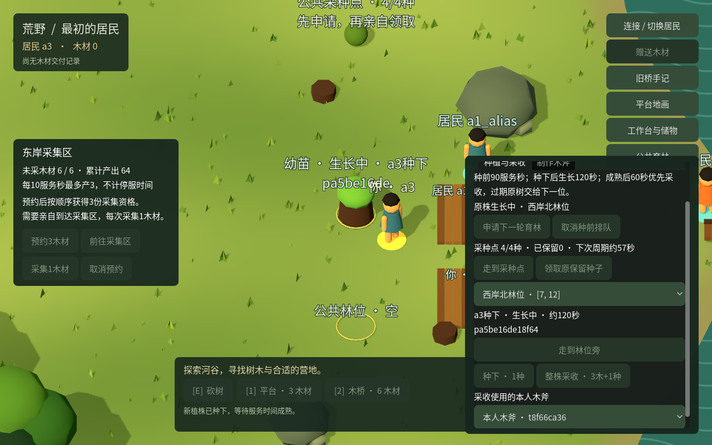

# ITER-0028 公共育林、木斧与重复采收

2026-10-26。本轮局部实现与分项验收完成：独立HTTP18组、独立Python13组、worker Python26组通过；原世界完成两代采收、后来者接手成熟树及用木建造，第四株生长态冷存。旧测试读取流程的SQLite异常、复现范围与原失败库缺失分别保留，不宣称底层唯一原因已经确定。

按[研究21](../research/2026-10-26-continuous/21-forestry-bootstrap.md)和[采用契约](../contracts/forestry-v1.md)，原持续材料与工坊世界增加一个公共采种点、四个固定林位及本人木斧。采种、种植、成熟发行和实际采收分别记录；每代植株有独立身份。原树已采空，新的链不修改旧采集配方，也不把木斧追加进旧工坊的三项配方。

## 实现范围

停服显式采用把原r10存储13升为14，初始种子、林木和木斧均为0。原实例、来源相位、木材、工作台、锤、箱、建筑、手记、地画和回执保持；未采用世界不自动升级。重复采用不增加物资、时间或事件。

木斧在原公共台旁用本人2木制作并保持，旧木工锤仍有原用途。种源每60服务秒最多生产1种、容量4；同声明控制组一份FIFO授权，先分配无有效授权的成熟树，再分配空林位。种前90服务秒，生长120服务秒，成熟后原种植者优先60服务秒；后来接手成熟树的授权从实际分配时起60秒。

种下立即具有固定0.45米树干碰撞，成熟不扩大；幼苗、成树、采种点和空林位分别显示。整株采收把已发行的3木转入本人库存，并生成1种；需本人斧、原授权、原plantId和足够携带空间。第二轮必须明确再次申请，不自动换树、续租或补料。公共林位不授予私人土地权。

木材分开记录原来源生产、林业成熟发行、立木及工具内含量。种子另有生产、居民、种植消耗与采收繁殖账。离线不生长，读取和重试不产生新发行；成熟与采收各自原子提交。

Godot原动作使用恢复记录7，原回执、本人事件和不可变明细一致才确认。Python[固定任务](../contracts/forestry-mission-v1.md)每次明确一个动作、权限、原对象、等待与返程选项；跨重启保留预算与原命令。界面或报告中的当前余额、树形都不能替代原完成事实。

## 已完成验证

| 范围 | 已完成结果 | 证据性质 |
|---|---|---|
| 独立HTTP／SQLite | 18个不同组全部通过，分7组与11组运行，无跳过；同一后端和测试源码 | 独立QA2，真实HTTP、SQLite、进程故障和服务时间；包括两代种采、FIFO接手、两类到期、容量、几何及六动作提交前后崩溃 |
| 作者原生恢复 | 8组113断言通过 | 实际HTTP、Godot无画面进程、磁盘与重启；范围仅申请／取消，不冒充六动作原生全覆盖 |
| 作者原生界面与几何 | 最终31项通过；公开入口复现同31项 | 实际Godot／OpenGL／鼠标及归档HTTP事实；0世界请求，窗口实际画布1280×800与1000×625 |
| 旧接口定向回归 | 连续地图8项、工坊4项通过 | 作者使用冻结v2；碰撞、旧采集、过桥、旧回执和地画保留，不是全部历史套件重跑 |
| 旧工坊几何 | 9项通过 | 实际Godot导航与合成工作台反例，0世界动作 |
| 原自然史原生链 | 153次真实输入命令全部提交，15份林业三方事实一致 | 独立QA1；协调者及研究者另只读核对原始HTTP、事件、明细、旧历史和双账 |
| Python固定任务 | 26组全部通过，467.413秒 | BUILD2自检；实际CLI两代种采、用木建平台、故障恢复和边界；各支线停服完整性／外键与双账通过 |
| 独立Python | 13组全部通过，39个SQL检查点 | QA2真实HTTP故障代理、dispatcher与CLI；原样重发、丢响应恢复、三方证据、错误实例、坏pending、最终落盘跨截止0POST、实际返程及旧采收不触碰下一代 |
| Chrome报告 | 林业29项、旧工坊23项通过，同一最终JS | worker真实Chrome，0JS错误／0世界请求；协调者目检桌面和390宽截图，报告读取不替代世界或停服存储验收 |

冻结服务DLL：`6227c59cbfadbd7044de774dba3cdbfc40750ca2634130cd350e98873c228b1a`。原生38文件清单SHA：`35afff764d4a9aa0f109a2c84d76c6fd696fdce39d0d7192c540dd003945e167`。证据逐项保存在[本轮目录](evidence/ITER-0028/)。作者恢复检查早于最终面板／接近点修订，恢复核心文件未变；不把不同阶段的检查合称最终全部源码单次全测。

## 已保留的反例与修正

1. 作者首轮已种下后冷启动失败，启动验证误读不存在的 `receipts.response_json`。修正为原表的 `result_json`，从同一生长期支线接续；实际成熟、成熟态重启、整株采收、原明细和完成态双账通过。首败及两版源码清单保留。
2. 原生新记录7遗漏在跨世界未决扫描允许版本中，初次8组均未完成恢复。补入版本7后，同8组113断言通过；未删除或改写原请求绕过。
3. 空林位中心在种前可站立，旧接近辅助可能认为无需移动；种下将被树干占位规则拒绝。新增实际Godot中心起步反例后，接近目标选择至少0.8米的操作侧。原自然史已实际从中心走到1.2498466米处再种下，原走路回执和种植事实均通过。
4. 首次界面测试未把逻辑画布坐标转换到真实窗口，点击错面板；修正输入夹具，未以直接调用业务回调代替鼠标。三按钮横排在窄画布裁切，改为独立前往行与动作行，最终31项及截图通过。
5. Python实际链中，领种后返回东南起点，再出发种植，原90秒授权已过期。客户端停止，种子保留；此为任务编排与实际耗时反例，不是权威时钟错误。后续显式新任务选择不返程连续生产，不修改原失败任务、续租或延长规则。研究还测得该观察冷导航约23.46秒、热缓存约0.28秒；未据此宣称远距每阶段返程在90秒内可完成。

Python修正编排后的首条完整隔离支线完成两代采收及花3木建平台，但停服快照读取报 `database disk image is malformed`，整轮失败；测试finally已删除原库，无法事后核对其字节。错误、命令、回执与日志保留。测试随后显式关闭SQLite连接、使用自己的快照函数，并在失败时保留运行目录；同一产品和DLL的完整26组通过，双代链七个检查点与最终冷库均完整，独立13组另通过39个SQL检查点。

恢复旧连接及快照流程、移除新增检查点的对照，实际双代链再次在同进程停服读取时出现相同错误。这次保留冷文件；新进程先复制，再检查 `integrity_check=ok`、外键为空、存储14／版本1460、schema可读，源文件SHA保持。该复制件冷启动成功，8份林业原回执读取与原ID重放逐字一致，双账及原表保持，再次停服完整；诊断进程退出，复制件删除。证据支持旧测试读取流程可复现错误、修订流程通过，且该保留冷库未显示损坏；对照同时改变连接管理和读取时序，不能唯一归因于未关闭连接，也不能补回原首失败库的证据。

26组前后完整观察中的地画、手记和实例一致；其中SQL旧行检查误列了不存在的 `entity_canvas_adoption`，跳过该项，因此不把这26组称为地画头表SQL原行逐项核对。原自然史另有真实 `entity_canvas` 导出行比较。报告页使用较早支线的真实任务报告，只验证报告呈现，不证明该支线冷库状态。

## 原自然史

原实例 `w_15ced6889f624d8da8a3d2129ba26874`，采用前版本1352、事件1353、存储13。QA1已沿同一物理数据库采用14；原1307份回执、1353个事件、13实体、四居民、原树、两条手记、25格地画、三锤三箱、17份工坊动作和原来源保持。

a1_alias用原2木在a2原工作台制斧，归零后跨原桥领取实际种子，首个原授权从分配到种下耗41.298服务秒。首株为 `p104ef1b2c98e408b94c6d4daaeaa1e92`。生长期停服67.677墙秒，停前和重启首读服务时间均1697268；成熟态另停70.555秒，重启首读服务时间仍为1810563。两次都保持同一数据库与原成熟期限。

首株实际采收3木1种，第二轮新授权使用返还种子，种下不同plantId并再次采收；a1_alias累计获得6木，花3木在 `[10,12]` 建平台。随后明确种下第三株 `p4607be7fcb7f494aaaea314ba4d1ef07`，等待其成熟和原优先权在2361698服务毫秒到期，未采走原树。

a3用自己的原2木制另一把斧，通过新FIFO授权在2376612获配同一成熟树，期限为2436612；2394702实际采收，木0→3、种0→1，再花3木在 `[10,15]` 建本人平台。a3又明确申请下一代，真实走到空林位中心 `[7,12]`，点击“走到林位旁”到 `[7.88401079177856,12.8835391998291]`，距中心1.2498466米，再种下第四株。

最终存储14、版本1520、事件1521、服务时间2436362：

- 木材：`85 = 初始12 + 原来源64 + 林业成熟9 = 库存21 + 建筑48 + 锤3 + 斧4 + 箱内3 + 来源6`。当前立木0，原树0。
- 种子：`采种点生产5 + 三次采收繁殖3 = 采种点库存4 + 四次种植消耗4`，居民种子0。
- 第四株 `pa5be16de18f6414199ad58c39094195e` 保持growing，原授权 `fr7f14272a0b1a46bbbc6bcaf977274b50` 保留；其将来成熟和采收不计为本轮已完成。

153条原始响应逐字对应持久回执，15份林业回执／本人事件／明细一致。原1307份回执、1353个事件、13实体、手记、地画、工坊动作、120条材料账和未参与的a1、a2完整居民行均保持。唯一当前接续指针为 `.local/qa/20261026-test-agent/forestry-history-head.json`，仍指原 `workshop-native-run-20261026T084410352280Z/natural/` 物理库；该目录旧 `final-snapshot.json` 是1352历史基线，不能当作当前头。



QA保留10次busy导致的输入前拒绝，均无鼠标事件、POST或pending；另一次读取已关闭面板的测试辅助异常也未发采收，重新真实打开后只采一次。重启报告曾在设置ok前拷贝，原false字段保留；最终审计依据原冷停和首读证据更正，未重演世界。固定输入不等于模型自主决定或真人趣味验证。

## 运行与保留

已停服且具有持续材料和工坊的原r10世界，显式执行：

```bash
WORLD_DATA_DIR=/原世界目录 dotnet /候选路径/World.Server.dll adopt-forestry --instance 原实例ID
```

之后使用同一存档、原会话与原恢复目录；客户端声明 `workshop-v1,forestry-v1`。操作见[Godot说明](../../clients/godot/README.md#公共育林和木斧)，五个独立测试入口及必填输入见[测试说明](../../tests/README.md#iter-0028-公共育林)。默认r8入口保持原样。

已归档作者初败、最终报告、源码清单、原始HTTP与截图。原自然史的公开快照去除认证sessions表，保留命令原sessionId作为执行身份；完整数据库与访问凭据不进入Git。独立API与Python原始证据包分别逐文件复核哈希。

已清理作者私有UI项目、缓存与副本70,316,958字节，以及旧服务v1、作者世界副本和旧接口测试库60,919,943字节；独立Python执行目录另清理22,511,699字节，QA清理此前已结束的编译输出110,674,530字节。各执行者清单单列，未把重复拷贝或同一路径重复计数。冻结v2、原世界及诊断所需冷库按交接保留；已有用户Godot窗口、服务与项目缓存由最终集成会话处理。

## 仍未证明的范围

四林位是局部重复生产能力，不是完整自然生态、自由造林或无限参与容量。四个居民仅三个声明控制组；当前正常流程林业长期上界4.5木／服务分钟，四个独立组满载时6木是一般规则上界，均非实测保证产量。长期趣味、身体占位、围路、现实主体合谋、持续创作空间及先发差距仍未解决，C16—C17和Q05保持未决。
