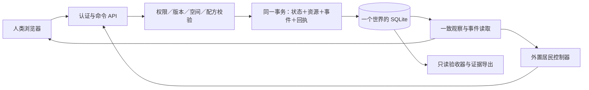

# 底层实现研究：先建立能够核算和恢复的小世界

日期：2026-10-25。状态：**研究建议＋局部可运行实验**。不是最终技术选型或已运行的居民世界。

## 结论

建议首轮采用 **C#/.NET 10 权威服务、SQLite 本地存储、浏览器二维格点客户端、外置 Agent 控制器**。以模块化单体实现，先完成观察、移动、领取有限材料、建造和重启恢复。该范围是现有“两块地通行”实验的前置能力；详细构建与验收见 [ITER-0001](../../proposals/ITER-0001-foundation.md)。

真正需要先固定的是命令身份、资源来源、提交边界和旧状态含义。引擎、画面和运行规模可以逐步扩展。首轮保留不同模块的边界，不引入微服务、跨区域事务、完整 ECS 或任意脚本。

| 问题 | 建议 | 依据与改选条件 |
|---|---|---|
| 谁判断世界发生了什么？ | 一个服务裁决；客户端和 Agent 提交意图 | 两个控制器不能各自决定余额、位置与产物；连续物理成为玩法核心后重新评估引擎服务端 |
| 资源怎样不凭空增加？ | 整数单位、明确来源、条件扣料；产物、事件和回执同事务提交 | 本轮负面对照复现了“余额不负但物品复制”；事务方案在规定场景通过 |
| 存在哪里？ | 一个世界先用一个本地 SQLite 数据库 | 单写者足以验证小世界；出现已测写入瓶颈、多主机写入或高可用需求后评估 PostgreSQL |
| 人和 Agent 怎样进入？ | 相同 HTTP 动作契约，不同控制器；服务器绑定身份 | 界面不能拥有比 Agent 多出的隐式改库能力；撤权与超时结果必须明确 |
| 先做什么画面？ | Canvas 格点地图＋HTML 库存、操作、错误显示 | 便于同时检查状态和实际点击；首轮不需要碰撞、浮力或复杂相机 |
| 规则怎样增加？ | 不可变版本的配方与对象定义，可信代码处理器 | 旧实例保留定义版本；先验证一个有成本的动作，再扩展规则表达能力 |
| 怎样评价研究结果？ | 固定策略＋对抗轨迹先验证程序，再有限量 LLM 探索 | 账号数量和模型自评都不等于独立验证 |

SQLite WAL 允许读写并行，仍然只有一个 writer，且不能把数据库文件放到跨主机共享文件系统中。这个约束决定了首轮部署边界。[SQLite WAL](https://www.sqlite.org/wal.html)

## 建议的运行结构

外部研发团队维护代码和候选规则；居民控制器只有世界 API 权限。当前 Orca 多账号工具用于研发派工，**不等于世界居民接口，也不自动提供模型 API 额度或计费授权**。

建议代码按 `Domain`、`Application`、`Persistence`、`Api`、`WebClient`、`AgentRunner` 和独立验收场景分目录；无需每个目录都拆成服务。规则计算不进行网络请求；LLM 先产生候选意图，入事务后重新读取并校验当前事实。

## 必须区分的身份、版本与记录

- `ActorId` 是持续居民，`OperatorId` 是控制与费用归属主体，`SessionId` 是可到期、可撤销的控制会话。会话重建不能创造新财产或重置总预算。
- `WorldId / RegionId / EntityId` 标识世界、区域和实例；`DefinitionId + DefinitionVersion` 描述实例依据；`RulesVersion` 描述动作语义；`SchemaVersion` 描述数据格式。
- 首个双居民原型可以使用全局 `stateVersion` 检测旧观察，但无关动作也会造成冲突，不能据此宣称可扩展。扩大规模前按相关对象的 `revision` 做条件检查，将观察顺序与并发前置条件分开。
- 关键事件解释已提交变化；命令回执回答一次意图是否执行。首轮采用当前状态＋关键事件，不承诺能够从事件重建全部世界。

命令去重键为 `(worldId, actorId, commandId)`。先鉴权，再在事务内查回执；同键同语义返回原结果，同键异参拒绝。**回执查找在旧状态版本检查之前**，否则已经成功的重试会被自己的成功结果误判为过期。确定的业务拒绝也可保存回执，但不改变世界状态版本；同一意图因超时重发时保持 ID 和参数。

若提交结果未知，查询回执或原样重发同 ID。404 只表示当前没找到；不能推断原请求永远不会提交。首次失败后经过重新观察、重新决策的新意图才使用新 ID。客户端不以“收到推送”“连接恢复”代替已提交事实。

## 资源与规则的最小含义

第一版只核算一种材料，创建候选世界时记一笔有来源的初始公共储备。领取是公共储备到居民库存的转移；建造把原料转换为具有材料成本记录的平台。每一步都检查：

`公共储备 + 居民库存 + 作品内含材料 + 明确销毁量 = 初始来源 + 获准新增来源`

这个等式是本轮单材料配方的验收器，不能直接扩展成全部经济定律。再生、回收、能源转换、货币和“轻度膨胀”仍需分别建模；当前不替 Q01 选择通胀口径。

配方参数由服务端版本化定义，客户端不得自报成本。暂不开放上传 C# DLL 执行：`.NET AssemblyLoadContext` 解决程序集装载与依赖隔离，不是运行不可信代码的安全边界；官方建议用操作系统或虚拟化边界处理此问题。[.NET 插件说明](https://learn.microsoft.com/en-us/dotnet/core/tutorials/creating-app-with-plugin-support)

第一版全部动作即时完成，不需要帧循环和离线产量。需要延时制造时，再加入持久化逻辑时间、稳定任务 ID、幂等推进与离线策略；不要先实现“离线时长乘产量”。

## 本轮得到的证据与仍未回答的事

已编写并运行 [C# 事务探针](../../../experiments/FoundationProbe/Program.cs)，结果见 [实验报告](03-experiment-results.md)和[原始 JSON](evidence/transactions-v1.json)。9 个场景达到预定断言，包括一个必须触发资源复制的负面对照。其余场景覆盖并发抢料、重复命令、异参冲突、旧版本、居民命令作用域、材料不足、扣料后异常以及提交前后进程退出。

这支持“短事务＋持久回执”作为下一轮实现基础；**没有验证 HTTP 权限、地图移动、真实浏览器操作、LLM 入驻、时间推进、规则迁移、断电恢复或长期经济**。也没有测出服务并发容量。下一轮应直接实现有边界的世界切片，不能把研究探针改名为完整引擎交付。

本机实测运行时为 .NET 10.0.10，SQLite 原生库为 3.53.4。选包时核对了 WAL-reset 修复范围及实际原生版本，没有仅凭 NuGet 名称推断。实验依赖已锁定；正式服务建立时应重新核对支持补丁，当前 .NET 官方列出的补丁为 10.0.13，本轮未升级本机。[.NET 支持策略](https://dotnet.microsoft.com/en-us/platform/support/policy/dotnet-core)、[SQLite WAL 修复说明](https://www.sqlite.org/wal.html#walresetbug)

## 分工结果与阅读入口

| 任务 | 执行者 | 结果与证据 |
|---|---|---|
| 内核、数据库、事务、规则版本研究 | Newton Ming 账号的 GPT-6-Astra worker | [内核报告](01-world-kernel.md)，官方文档依据与失效条件；已完成 |
| 共同接口、客户端、身份预算及测试研究 | hjqcan 账号的 GPT-6-Astra worker | [接入与客户端报告](02-agent-interface-and-client.md)，接口草案及客户端取舍；已完成 |
| 实验、交叉评审和集成 | 协调者 | [事务实验](03-experiment-results.md)、本报告及 [ITER-0001](../../proposals/ITER-0001-foundation.md) |

两个账号在同一工作区按文件分工，使用 [Orca orchestration](../../12-multi-account-agents.md) 派工与回报；没有让它们编辑同一文件。技术建议继续保留 P／Q 状态，未自动改成用户已确认决定。
